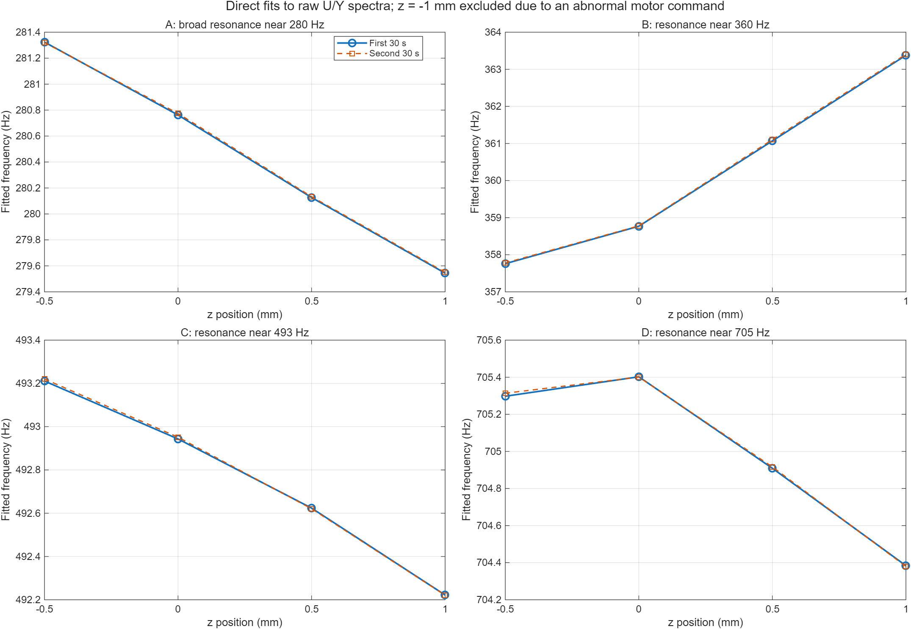
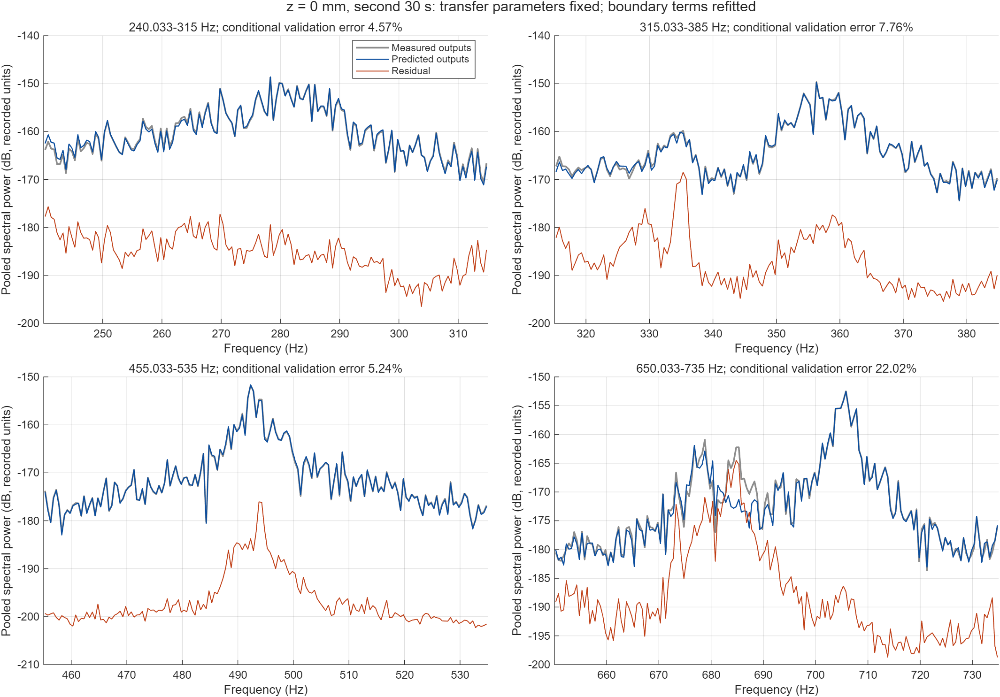
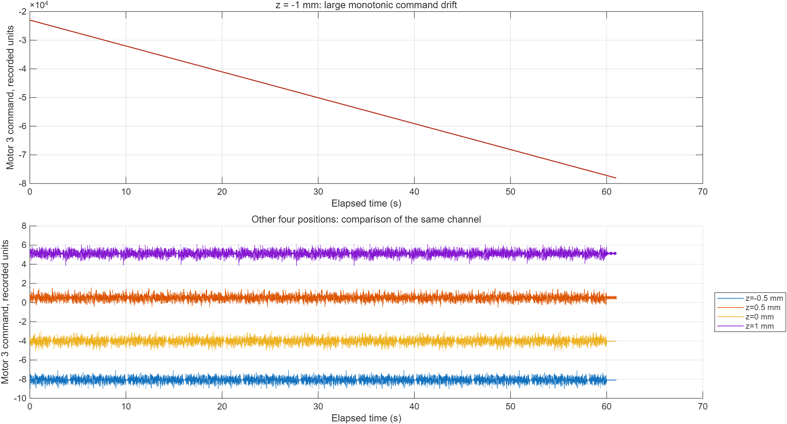

# 实验数据初步辨识与位置比较

日期：2026-10-15。原始数据：`experiment_data/auto_identify_motor1234_z*.mat`。本报告仅使用这批实测记录，不把仿真频率作为辨识真值。

**目前可以得到两个初步结论：四个正常位置均能辨识出重复出现的主要共振特征；这些特征随位置存在可分辨的变化，尤其是约 360 Hz 附近。** −1 mm 记录有明显的电机指令异常，不能与其余记录作为同类正常工况比较。本次得到的是局部模态模型，还没有完成论文中的通道相对动态辨识和解耦自校准。

## 1. 数据范围与处理

每份记录包含四路电机总指令 `u_Motor1`–`u_Motor4`、四路传感器信号 `pre_y_0__0_`–`pre_y_3__0_`。采样频率约 5000 Hz，时长 61 s，各通道时间戳对齐。实验在闭环下进行，当前记录的输入是总电机指令。

按用户要求，仅分析 **25 Hz 以上**的数据，不把十几 Hz 的重力补偿弹簧模态作为目标。截取频带并不意味着弹簧在更高频段的影响严格为零，本次由局部平滑背景项吸收远离目标共振的响应。

去掉开始的 1 s 后，将余下数据分成前、后各 30 s。前半段用于拟合，后半段用于条件验证及单独重新估计频率。两段来自同一次记录，不是两次独立实验；所得差异不等于统计置信区间。

文件名的位置单位为 mm。正常记录中，位置每增加 0.5 mm，传感器均值相应增加约 0.0005 个记录单位，与传感器以米记录相符。电机指令的物理单位尚未核实，因此不把幅值标成 m/N 或 m/A。额外变量 `d_z` 在本批五份文件中均为零，不能把它当作外加辨识激励。

## 2. 本次实际使用的辨识方法

先用 2 s 窗的多输入多输出 Welch 频谱估计寻找主要峰及初值。随后直接拟合原始输入、输出的复数 DFT，最终参数不以 Welch 频响为目标。每个局部频带保留全部 DFT 频点，频率间隔约 0.0333 Hz。

对输出通道 j，在局部频带内使用

\[
Y_j(\omega_k)=\sum_{q=1}^{4}G_{jq}(\omega_k;\theta,C)U_q(\omega_k)
+T_j(\omega_k;\theta,b)+E_j(\omega_k).
\]

其中，所有输入输出通道共享极点；\(\theta\) 包括频率和阻尼比，\(C\) 为各通道留数及局部背景系数，\(T_j\) 描述有限记录的边界/瞬态项。采用共轭离散极点基函数，极点与连续时间模态参数的关系为

\[
p_i=\exp\!\left[\frac{2\pi f_i}{f_s}
\left(-\zeta_i+\mathrm{i}\sqrt{1-\zeta_i^2}\right)\right].
\]

对给定 \(\theta\)，留数、背景和边界系数由实部/虚部堆叠后的线性最小二乘消去；再用非线性最小二乘优化 \(\log f_i,\log\zeta_i\)：

\[
\min_{\theta,C,b}\sum_{k,j}
\left|w_k\left[Y_j-\sum_qG_{jq}U_q-T_j\right]\right|^2,
\qquad w_k=(f_k/\bar f)^2.
\]

这是固定频率权重，不是估计的逆噪声协方差。各局部窗口的极点数分别为：240–315 Hz 一个，315–385 Hz 两个，455–535 Hz 一个，650–735 Hz 两个。局部背景是复常数和随频率线性变化的项；它只服务于窗口内的近似，不能当作论文全频带模型中的物理直通项 D。各通道留数未强制秩一，也没有将六个拟合极点直接解释为六个已确认的机械模态。

**为什么没有采用更长窗的 FRF 反演结果？** 4 s 窗检查中，z = 0 mm 前半段归一化输入谱矩阵的条件数中位数约为 4.3×10⁶，最大约 9.6×10⁹，直接谱矩阵求逆明显不可靠，其参数结果已弃用。当前原始频谱拟合的列归一化线性设计矩阵条件数约 1.95–3.15，且满列秩。这仅说明线性子问题数值条件较好，不能据此宣称全部非线性参数都具有可靠协方差或闭环估计无偏。

## 3. 主要频率随位置的变化

以下列出四个较清楚且两段结果一致的共振特征，A–D 仅为标签，不对应有限元模态序号。表中为前半段估计的极点固有频率，单位 Hz。

| z / mm | A：约 280 Hz | B：约 360 Hz | C：约 493 Hz | D：约 705 Hz |
|---:|---:|---:|---:|---:|
| −0.5 | 281.32 | 357.76 | 493.21 | 705.30 |
| 0 | 280.76 | 358.77 | 492.94 | 705.40 |
| 0.5 | 280.13 | 361.07 | 492.62 | 704.91 |
| 1 | 279.54 | 363.38 | 492.22 | 704.38 |

这 16 个估计中，前、后半段频率差的最大值为 **0.0359 Hz**。从 −0.5 mm 到 1 mm，B 的频率增加 **5.619 Hz，约 1.57%**；A 降低约 1.780 Hz，C 降低约 0.989 Hz。D 的变化较小且并非单调，其所在频带还存在未充分解释的相邻响应。

阻尼比估计如下，数值单位为百分比。它们仍是当前局部模型下的初步估计，尚未排除闭环噪声、局部模型结构及通道动态的影响。

| z / mm | A 阻尼比 / % | B 阻尼比 / % | C 阻尼比 / % | D 阻尼比 / % |
|---:|---:|---:|---:|---:|
| −0.5 | 2.631 | 0.224 | 0.357 | 0.154 |
| 0 | 2.587 | 0.303 | 0.362 | 0.155 |
| 0.5 | 2.540 | 0.325 | 0.349 | 0.152 |
| 1 | 2.574 | 0.346 | 0.341 | 0.146 |

此外，315–385 Hz 窗内还存在约 330–344 Hz 的特征，650–735 Hz 内还有约 678–681 Hz 及邻近响应。它们已保留在全部参数表中，但物理模态对应关系尚未确定。没有为了吻合原来的五阶仿真模型而删除这些特征。

## 4. 后半段验证与跨位置预测

验证时固定前半段得到的传递函数参数，只重新估计后半段记录的边界/瞬态系数。采用与拟合相同的频率权重，报告四路输出的联合相对误差：

\[
\varepsilon=\frac{\|W(\widehat Y-Y)\|_F}{\|WY\|_F}.
\]

因此，下表是**带边界项重估的条件验证**，不是完全不使用验证输出的自由预测。未补偿边界项时的误差也完整保留在 `raw_local_validation.csv` 中。

| z / mm | 240–315 Hz | 315–385 Hz | 455–535 Hz | 650–735 Hz |
|---:|---:|---:|---:|---:|
| −0.5 | 4.58% | 5.01% | 5.66% | 11.16% |
| 0 | 4.57% | 7.76% | 5.24% | **22.02%** |
| 0.5 | 4.58% | 8.26% | 5.29% | 4.86% |
| 1 | 5.18% | 8.25% | 5.50% | 3.42% |

除两个高频窗口外，其余误差为 3.42%–8.26%。z = 0 mm 的 650–735 Hz 窗内，在约 680–690 Hz 仍有明显结构性残差；当前双极点局部模型不足，不能把整段拟合称为成功。下图对原始输出频谱作 0.5 Hz 分箱显示，数值误差计算使用全部原始频点和复数响应，未在幅值图上计算。

进一步固定 **z = 0 mm 的传递函数模型**去预测其他位置，并采用相同的边界项处理。在位置变化最明显的 315–385 Hz 频段：

| 被预测位置 / mm | 该位置自身模型误差 | 使用 z = 0 mm 模型的误差 |
|---:|---:|---:|
| −0.5 | 5.01% | 45.03% |
| 0 | 7.76% | 7.76% |
| 0.5 | 8.26% | 134.50% |
| 1 | 8.25% | 179.48% |

相对复输出误差可以超过 100%，特别是窄共振发生频移、预测峰与实测峰错位时。该比较包含频率、阻尼、留数和背景的共同变化，不是只把频率变化单独归因的试验。其结果说明：**在本批数据中，一个固定的 z = 0 mm 局部模型不能良好覆盖全部位置。** 每个位置目前只有一次记录，尚不能排除温度、测量顺序和其他工况变化，不能据此把全部差异严格归因为 z 位置。

## 5. −1 mm 记录的异常

该记录的电机 3 指令从约 **−22985** 变化到 **−78089**，均值约 **−50532**，线性变化速率约 **−903.3 个记录单位/s**；去掉直线趋势后的标准差仍约 2.67。其他四个位置同一路指令均值约为 −8.09、−4.04、0.52 和 5.13，标准差约 0.30。

这是需要核对的记录或控制工况异常，不能仅作去均值、去趋势处理后就视为正常位置实验。是否涉及限位、饱和、积分累积或记录信号定义，目前无法仅凭文件确定。本次保留原始数据和诊断结果，但不把该记录用于正常位置模型比较。

## 6. 图表的解释及本轮结论边界

- `raw_z0_bode_magnitude.png` 和 `raw_z0_bode_phase.png` 为 4×4 通道图。蓝线只画实际拟合的四个局部频带，其他频段没有拟合曲线；它不是完整的 25–800 Hz 参数模型。
- Bode 图灰线是后半段数据的 2 s Welch 初步估计，受谱窗和闭环噪声影响，不能当作无偏真值。最终目标函数使用原始 U/Y 频谱，直接验证应以上一节的复输出残差为准。
- 相位按频率展开；每个局部模型只允许平移整数个 360° 以选择显示分支，没有逐点修改复频响。噪声或反共振附近的展开分支不宜用于单独提取时延。
- 当前闭环数据只有总输入，未在本轮加入真实控制器、外部激励或噪声模型。因此这是一轮探索性模态辨识，不能引用论文的一致性定理作为本轮估计的保证。
- 本次尚未辨识相对通道时延/滤波差异，也未更新刚体零空间或解耦矩阵。模态频率能被稳定估计，不代表这些校准目标已经完成。

下一步适合先固定 z = 0 mm，补齐当前约 680–690 Hz 的局部响应并核对真实控制器和外加激励记录，再接入论文中的联合辨识入口。位置变化可以作为模型适用范围的验证因素，目前不必扩展成新的论文主线。

## 7. 结果与复现文件

主要结果：

- `main_modal_frequencies.csv`：四个主要特征的频率、阻尼及两段比较。
- `raw_local_modes.csv`：全部六个局部极点候选。
- `raw_local_validation.csv`：训练、条件验证及未补偿边界项的误差。
- `cross_position_prediction.csv`：全部四个频带的跨位置预测误差。
- `record_diagnostics.csv`：原始均值、异常指令与传感器均值。
- `raw_local_models.mat`：局部模型系数、极点、验证频谱与预测。
- `identification_summary.json`：机器可读汇总。

复现顺序为 `audit_experimental_records`、`fit_experimental_modes`（初值与诊断）、`fit_raw_experimental_modes`（主要估计）、`summarize_raw_experiment`、`check_cross_position_prediction`。原始 MAT 文件未修改；4 s Welch 反演失败检查保留在 `resolution_4s`，其中结果不应作为最终模型引用。
