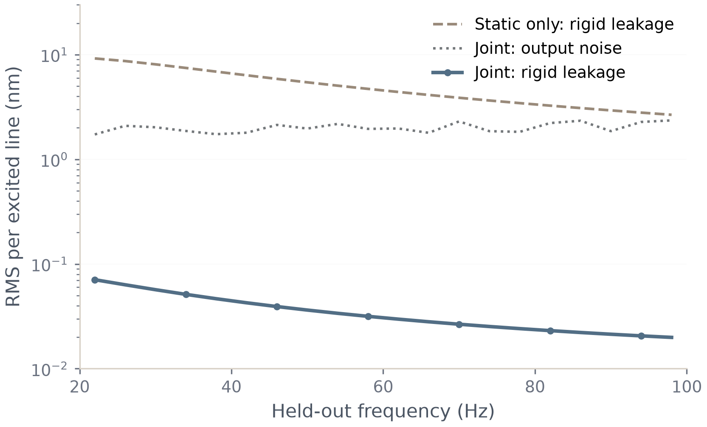

# 五阶对象的数字闭环辨识与校准验证

日期：2026-10-14。范围：matlab/0 原五阶对象、D=0、模型正确的线性数字闭环仿真。原模型与旧试验均未覆盖。

## 结论与重要修正

完整外生激励 d、总指令 u、四路输出 y 的数据链已经跑通。在指定的合成通道失配下，联合辨识后的输出校准将独立验证低频带的刚体泄漏压到噪声底以下，并提高柔性信号相对于“刚体泄漏加噪声”的比值。公共且重复的滤波也已验证。它支持该实现的可行性和该工况的工程收益，不能替代真实硬件失配量级与实验验证。

闭环实现暴露了原 32 个独立滤波系数模型的问题：M 为秩三仍不足以保持机械积分阶次。令

G(s)=M/s²+H₋₁/s+O(1)，H₋₁=−(a+ℓ)∘M。

若 n_yᵀH₋₁n_u≠0，则刚体主块的 Schur 补含 1/s，增加一个原点积分极点。代表性旧拟合的该系数为 −5.2734×10⁻⁸，真值约 5.0822×10⁻²¹；旧批次 56 个起点未通过所用闭环稳定性检查。它们保存在 outputs，未作为成功结果。

修正为保留物理模型已有的 a_jk=a_j1+a_1k−a_11，使用 7 个一次系数坐标，仍放开 16 个二次系数，共 23 个滤波系数、125 个总参数。此时 a+ℓ 具有两侧加性结构，n_yᵀH₋₁n_u=0。重复根附近仍无需分配滤波根。已有大族的局部识别证明可限制到该光滑子族；有限采样识别和信息条件仍需独立满足。

修正依据原点结构推导作出，随后在相同训练数据、随机种子及预算上重跑；不是按验证集结果选模型。该修正不构成扩大到一般高阶通道滤波的新方向。

## 数据与实现

- MATLAB R2025a；采样 5 kHz，每周期 5000 点，丢弃 2 s 启动段后保留 1 s。四个输入方向分别注入多正弦，每频线峰值 0.1 N；196 条训练频线的注入 RMS 约 0.99 N。
- 训练频线 20:4:800 Hz；验证频线 22:4:798 Hz，彼此不重合；验证使用 8 组新噪声和新激励相位，保留完整启动与测量记录。
- 输出/输入滤波时间常数分别为 [20,31,9,25] / [17,11,23,35] μs；通道时延分别为 [0,40,80,15] / [25,65,35,100] μs。公共滤波组将全部时间常数改为 20 μs，仍保留不同的时延。均为合成条件。
- 名义几何对各传感列和执行器行按 1% 尺度加高斯扰动，再构造秩三矩阵；1% 是扰动生成尺度，不声称每个矩阵误差恰为 1%。固定反馈由名义几何构造，刚体控制频率 15 Hz，微分滚降 120 Hz。
- 传感器噪声为每采样点 100 nm 标准差的独立白噪声，包含反馈导致的输入—噪声相关。时域 u−d+Ky 相对误差约 2.05×10⁻⁸；输入噪声相关指标约 0.616。
- 状态空间时域生成器与辨识预测器独立实现。预测包含精确零阶保持与分数拍时延，不用 Padé 近似或有限混叠和。与独立 c2d 的频响相对差约 3.84×10⁻¹³；模型方向导数差约 2.33×10⁻⁸，闭环残差和约束导数也通过差分核对。
- 32 组独立先导记录仅用于初始化和固定正下限。最终残差为完整输出频谱减去已知反馈下对外生 d 的预测；不以 Y/U 比值作似然，不用 LRM。权重为训练重复组的样本方差倒数，在优化中固定；统计解释采用文中趋于确定正定极限的数据权重扩展。
- 16 起点、每起点 400 次迭代/4000 次函数评估，约束最小二乘内点法，解析导数。两个附加噪声重复仅 4 起点，属于诊断，不能与 16 起点组直接比较算法成功率。选解只看训练代价及预设可行性、收敛和稳定性条件。
- 数字补偿采用有理部分双线性离散化及整数延迟加一阶 Thiran，各侧公共延迟 400 μs。数字真参数参考也包含实现误差，不等于连续精确抵消。

## 辨识结果

| 案例 | 严格收敛 | 起点数 | 验证闭环误差/% | 最大频率误差/% | 最大阻尼误差/% |
| --- | --- | --- | --- | --- | --- |
| distinct_N32 | 11 | 16 | 0.02346 | 0.000818 | 0.0976 |
| distinct_N8 | 10 | 16 | 0.06159 | 0.004895 | 0.2109 |
| common_N32 | 16 | 16 | 0.02498 | 0.004632 | 0.3908 |
| distinct_repeat2_N32 | 4 | 4 | 0.02747 | 0.003493 | 0.5628 |
| distinct_repeat3_N32 | 1 | 4 | 0.02597 | 0.001430 | 0.4917 |

N=8 使用主 N=32 的前八组记录；两个附加重复使用新的训练噪声与激励相位，但共享先导、对象和独立验证集。56 个起点均满足事后检查的约束与闭环稳定性，42 个满足严格数值收敛门槛；11 个因步长过小退出但未达 KKT 门槛，3 个达到预算。没有把正退出标志一概当作收敛。

无噪声检查在 250 次迭代后通过约束求解门槛，代价 8.075×10⁻⁷，留出频点的对象频响相对误差 6.606×10⁻⁶；这不是精确到机器误差的参数恢复，也不是全局最优证明。

主 N=32 的左右刚体零空间角度误差约 0.001489° / 0.001083°，输出/输入相对通道复响应的逐频逐通道最大相对误差约 1.080% / 0.412%。这是相对响应精度，不是单个滤波常数或绝对时延的精度。

## 独立闭环输出验证

下表对应验证频线 22–98 Hz。B1 和 B4 使用同一联合估计得到的静态零方向，B1 关闭动态补偿；它是机制消融，不是独立拟合的既有静态算法。原反馈和实际总输入保持一致，只有输出后处理不同。刚体与柔性分量由真实对象在同一闭环总输入下分解。噪声经过实际数字校准器处理。

| 案例 | B1 泄漏/nm | B4 泄漏/nm | B4 噪声/nm | B1 信噪比/dB | B4 信噪比/dB |
| --- | --- | --- | --- | --- | --- |
| distinct_N32 | 24.524 | 0.1726 | 9.057 | 6.488 | 15.695 |
| distinct_N8 | 24.537 | 0.6723 | 9.056 | 6.484 | 15.673 |
| common_N32 | 24.610 | 0.3201 | 9.032 | 6.473 | 15.723 |
| distinct_repeat2_N32 | 24.526 | 0.3080 | 9.055 | 6.488 | 15.692 |
| distinct_repeat3_N32 | 24.524 | 0.1423 | 9.056 | 6.488 | 15.696 |

表中噪声是单周期在所列频线上的带限 RMS，再对四个激励方向与八组噪声取功率平均；不是原始全带宽 100 nm 标准差，也不是八组相干平均后的噪声。信噪比定义为 20 log10(柔性 RMS / sqrt(刚体泄漏 RMS²+噪声 RMS²))。

主组中柔性 RMS 约 55.18 nm；动态校准使泄漏约减小 142 倍，信噪比提高 9.21 dB，补偿后噪声基本不变。真参数数字参考的泄漏仍约 0.00780 nm，验证了不能宣称数字实现严格零泄漏。

图中纵轴是每条激励频线的 RMS，不能直接拿某一频点值与表中的频带合成 RMS 比较。数据和 SVG/PNG 均已保存，未绘制虚构的置信区间。

## 双侧柔性通道与边界

另在精确采样对象上评价双侧零空间映射，并对每个频点归一化实际输入能量。它不是更换反馈控制器后的闭环标量传递函数。主 N=32 的刚体/柔性 L2 比约 0.01343%；五个模态相对数字真参数投影的幅值保留为 99.757%、100.218%、100.203%、101.451%、103.311%。这不表示保留了原物理响应的约 100%；原布局本来就仅将很小比例的模态投影到双侧零空间。

五组中相对于数字参考的保留率范围为约 94.3%–109.4%；小样本组和附加重复暴露出更大的目标幅值偏差。单个成功案例不能代替不确定度报告。

所选解均没有活动盒边界或所检查的非线性约束，但缩放 Jacobian 条件数约 6.2×10⁸–2.1×10⁹。所有起点均未通过另设的严格未约束 score 门槛。约束求解器的相对最优性检查与统计渐近正态所要求的优化误差条件不同。因此本批只验证闭环实现及有限工况的校准收益，不验证一致性速率、正态近似或置信覆盖，不声称物理参数已充分分离。

没有验证饱和、量化、硬件滤波模型误差、一般低频刚度摩擦、反馈内直接部署输入补偿或输入整形任务。真实装置失配是否落在有收益区间仍由实测回答。下一步优先采集硬件通道响应和独立验证数据；只有保留不确定度实用性主张时，才追加大规模覆盖率试验。

## 文件与复现

- `clv_run_batch('constrained-lsq',true)`：五组主运行；已存在的起点结果会复用。
- `outputs_structured/manifest.json`：配置与种子；`code_snapshot/`：当时运行代码。
- `outputs_structured/summary.json`、`compact_summary.csv`：全部结果和紧凑表；各案例 `start_*.mat/json` 与 `selected.mat` 保存所有起点及选择结果。
- `outputs/data_distinct.mat`：原始主数据；`outputs_structured/data_common.mat`、各案例 `data.mat`、`test_distinct.mat`：先导、训练和验证数据。训练保存完整频谱及原始记录例子，验证保存完整时域记录；不是声称保存了每个训练时域样点。
- `outputs/expanded_origin_audit.json`：旧 32 系数族的原点反例；`outputs_structured/final_audit.json`、`data_integrity.json`：事后约束、稳定性和数据一致性核对。
- `figures/lowband_source.csv`、`plot_closed_loop.py`：图的源数据和生成程序。

当前论文源文件已同步上述结果和模型修正。LaTeX 编译状态另见源文件检查记录，不能以已保存代替编译成功。
