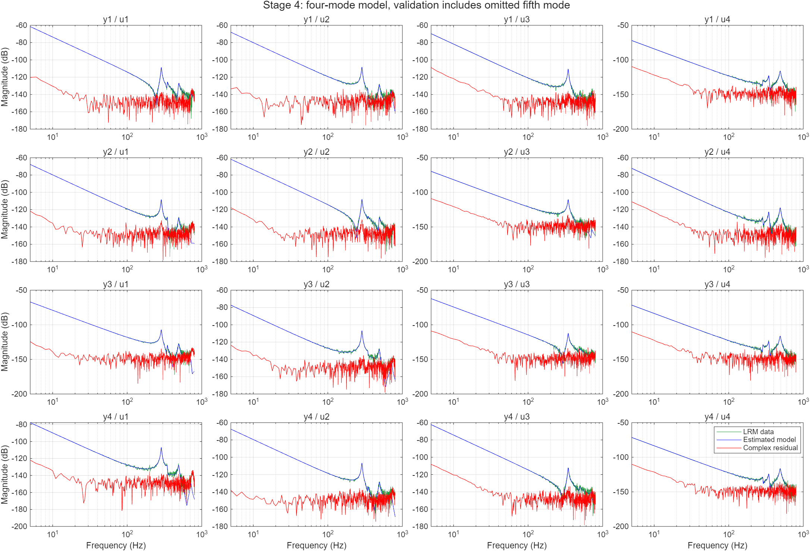

# MATLAB 模态辨识修复验证报告

验证日期：2026-10-12。

本次已修复 0～4 的主流程，辨识模型保留 **3 个刚体方向、4 阶柔性模态**。仿真对象的第 5 阶柔性模态继续作为未建模动态。实际验证从保存的四输入四输出时域记录开始，重算 LRM，再运行四个辨识阶段；没有重新运行 Simulink。

## 主要修复

| 问题 | 处理 |
|---|---|
| 绘图使用真值覆盖估计参数 | 移除辨识路径中的真值调用，图线直接使用本次保存的估计参数 |
| 刚体矩阵只保留一个奇异方向 | 保留三个刚体方向；四个柔性残差矩阵各保持秩一 |
| 归一化映射与雅可比不一致 | 统一 `[a1; a2; vec(B)]` 定义，补齐归一化分子的极点导数 |
| 优化停止准则不可靠 | 使用加权残差、阻尼和下降步接受机制；统一缩放权重不会导致提前停止 |
| 各阶段参数文件不兼容、分子索引错位 | 新建明确的 `results/stage1.mat`～`stage4.mat` 数据传递，校验配置和数据源 |
| 固定大正则项、直接求逆造成数值偏差 | 使用列缩放及 QR/最小范数求解 |
| LRM 重复瞬态列和错误索引 | 每个输出只拟合一个共同瞬态，使用缩放最小二乘 |
| 无效频点进入回归 | 在选择频点及数值入口拒绝零、NaN、Inf 和不匹配的 FRF 数据 |

在本次刚体矩阵上，保留三个奇异方向的初始化截断相对误差为 **0.005037%**。修复后的模态投影加权目标从 **1.0400461×10⁻⁶** 降到 **8.5458406×10⁻⁷**。

## 四阶辨识结果

阻尼为无量纲阻尼比。

| 阶次 | 加性模型频率 / Hz | 加性模型阻尼比 | 最终模态频率 / Hz | 最终模态阻尼比 |
|---|---:|---:|---:|---:|
| 1 | 286.57896 | 0.01156195 | 286.58067 | 0.01155383 |
| 2 | 344.96643 | 0.01245008 | 344.96932 | 0.01239603 |
| 3 | 490.44684 | 0.01725175 | 490.43315 | 0.01721535 |
| 4 | 720.00000 | 0.02745438 | 715.14598 | 0.01607832 |

第 4 阶加性频率触及了设定的 720 Hz 上界，说明该阶估计受到边界和数据/模型不匹配的影响。模态结构投影后频率为 715.15 Hz。当前结果不能证明截断偏差已消除，也不能将第 4 阶估计认定为无偏。

## 分频段验证

下表比较最终四阶模型与重算的 LRM 数据。普通误差为 `norm(G-Ghat,'fro')/norm(G,'fro')`；加权误差为实虚部堆叠后 `norm(sqrt(W)*residual)/norm(sqrt(W)*data)`。两者使用复数频响，因此包含相位误差。加权指标的通道幅值下限按各验证频段分别计算。

| 验证频段 | 普通复数相对误差 | 加权复数相对误差 |
|---|---:|---:|
| 5～720 Hz | 0.53745% | 4.09783% |
| 200～720 Hz，柔性辨识频段 | 10.23538% | 28.46393% |
| 大于 720～800 Hz，含未建模第五阶影响 | 94.88571% | 103.95782% |
| 5～800 Hz，全验证频段 | 0.54805% | 4.94632% |

全频段普通误差由低频刚体响应主导，不能单独用 0.55% 表示柔性模态拟合质量。高频残差保留了未建模动态、测量/频响估计误差等影响；未将其全部归因于第五阶。加权相对误差可以超过 100%。



绿色：LRM 数据；蓝色：估计模型；红色：复数残差的幅值。

## 实际求解状态和与原方法的区别

- 第 1 步：固定初始极点，单次加权线性最小二乘，使用 341 个频点。
- 第 2 步：RIV 迭代 9 次，按相对参数变化停止。
- 第 3 步：RIV 迭代 10 次后无下降方向，状态如实保存为 `no_descent`。随后额外执行有频率边界的加权输出误差最小二乘细化，5 次迭代，`exitflag=3`。这是额外数值优化，不应将结果表述为单纯 RIV 已收敛。
- 第 4 步：加权模态结构投影 12 次迭代，按步长或目标变化停止。

频响权重由通道幅值构造。第 4 步使用加性模型频响最小二乘的局部信息矩阵平方根，不宣称它是由重复实验估计的统计协方差。当前验证支持“代码主流程及所测数值性质已修复”，不等于完整复现论文中的统计效率、置信区间或全部实验结论。

## 测试和独立审阅

MATLAB 回归测试 **13 项通过，0 项失败，0 项未完成**。覆盖：多刚体和非方阵重构、3×4 且含柔性模态的雅可比有限差分、精确及扰动初值下的投影、整体权重缩放、无噪声四阶 RIV 恢复、刚体复数相位、LRM 共同瞬态、频率边界、无效输入拒绝及完整四阶段数据传递。逐项记录见 `test_results.csv`。

独立只读审阅核对了归一化公式、复数堆叠、刚体扣除、模态秩约束和阶段数据传递。审阅提出的无穷大频点检查已补上，非方阵柔性雅可比测试也已补充并通过。

30 个主流程、公共函数和测试文件通过 MATLAB 代码分析，未报告消息。备份中全部 63 个原始 MAT 文件与当前文件的 SHA-256 校验一致。

## 复跑和文件

在 `matlab` 目录运行：

```matlab
result = run_identification(true, true);
tests = runtests('tests');
assert(all([tests.Passed]));
```

`run_identification(false)` 可仅使用现有频响重跑，不绘图。第 3 步细化需要 Optimization Toolbox。

- `identification_result.mat`：本次完整结果与诊断。
- `identified_modes.csv`：四阶频率、阻尼比。
- `stage1.mat`～`stage4.mat`：各阶段结果。
- `modal_validation.png`：最终 16 通道图。
- `../README_修复说明.md`：运行方式、配置和数据流说明。
- 项目根目录 `backup_before_fix_20261012.zip`：修改前备份。

原时域数据和原 1～4 目录下的 FRF 文件保留。新生成的 `0/LRM_data.mat` 是主流程统一使用的频响输入。
