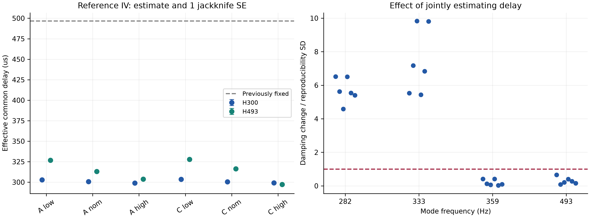
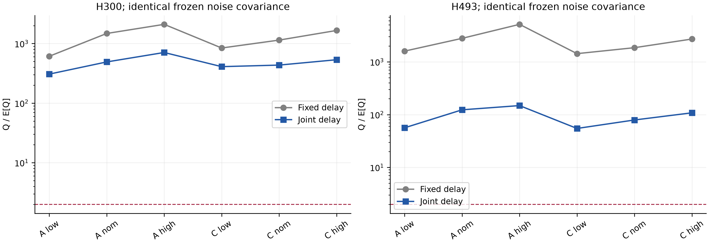
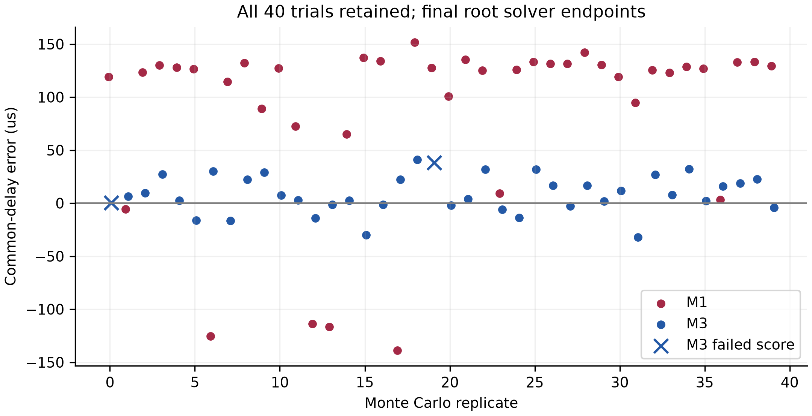

# 时延联合估计可行性检查

**结论：按预先给定的判据，建议论文保留时延估计这一项，至少必须报告其对高频阻尼测量的影响。判据(a)和(b)明确通过。当前证据不支持宣称“所有窗口均能可靠联合辨识物理时延”，也不支持把固定时延的影响写成低于测量复现性。**

高频的24个全记录端点（6记录×2窗口×2方法）及164个删除周期端点最终通过严格score；低频原IV–GN的12个全记录端点全部未通过。追加完整求根后找到9个低频代数根，但仍出现毫秒级、包含大量负值的有效时延，并对初值敏感，不能当作可信物理时延标定。40次已知时延仿真中，原IV–GN的参考IV失败39次；改为同一IV方程的完整求根后仍有2次未通过。上述失败均保留。

## 1. 范围、数据与计算口径

仅使用A和C++++的6条既有记录。低频3–25 Hz保留158个原参数；H300保留200个原参数（约263 Hz背景分量仍是干扰参数，不当成板模态）；H493保留74个原参数。各自仅增加7个结构化时延参数，分别为165、207、81维。C0/C1、D0/D2、ZOH与逐模态瞬态没有替换。M1用窗口内全部DFT点，M3仅用外部周期激励谱线，参考输入随当前模型更新。噪声谱为同记录非激励点0.5 Hz平均，窗口两侧各外扩2 Hz；全长未归一化DFT的协方差为NΦ。

公共时延网格以原有效公共值为中心，范围±200 μs、步长10 μs。每点在原极点处剖面求线性系数，随后从原端点和两个相隔至少50 μs的低残差网格点启动完整联合IV。网格用于初始化，并不是把时延约束在该区间内。输出/输入零和差异以Helmert正交基实现；计算单位100 μs。由exp(−sτ)给出的解析时延导数已核查。两个零和向量共8个分量但只有6个独立自由度，连公共项共7个。

## 2. 原有效时延的加性结构

以下均已包含此前减去100 μs的修正，本次未再减一次。约束最小二乘的公共项为 **496.655417 μs**。

| 侧 | 1 | 2 | 3 | 4 |
| --- | --- | --- | --- | --- |
| 输出 a (μs) | 84.291414 | 33.961534 | -44.730265 | -73.522684 |
| 输入 b (μs) | -17.341442 | 30.356900 | 140.950590 | -153.966047 |

有效矩阵τ（μs）：

| 输出\输入 | 1 | 2 | 3 | 4 |
| --- | --- | --- | --- | --- |
| 1 | 563.605389 | 611.303731 | 721.897421 | 426.980784 |
| 2 | 513.275509 | 560.973851 | 671.567541 | 376.650904 |
| 3 | 434.583710 | 482.282052 | 592.875742 | 297.959105 |
| 4 | 405.791291 | 453.489633 | 564.083323 | 269.166686 |

最大绝对结构残差2.17e-13 μs，零和约束满足舍入精度。它说明**当前使用矩阵本来就是加性结构**，并非由新实验独立证明硬件时延可精确拆成两端纯时延。

## 3. 统一偏移敏感性

六个偏移档全部计算，并另做零偏移复算，共252个拟合；初始20个未通过端点在不改方程的半步松弛后全部通过。原端点与精化端点均保存。下表对6条记录、正负六档取最大绝对变化；零偏移不参与最大值。阻尼变化单位为百分点，避免与相对百分数混淆。

| 模态/Hz | 方法 | max |Δf|/Hz | max |Δζ|/百分点 | 复现性SD/百分点 | 变化/SD |
| --- | --- | --- | --- | --- | --- |
| 低频1 | M1 | 0.000042 | 0.000439 | 未给定 | — |
| 低频1 | M3 | 0.000037 | 0.000247 | 未给定 | — |
| 低频2 | M1 | 0.000123 | 0.001134 | 0.100000 | 0.01 |
| 低频2 | M3 | 0.000043 | 0.001420 | 0.100000 | 0.01 |
| 低频3 | M1 | 0.000069 | 0.000458 | 未给定 | — |
| 低频3 | M3 | 0.000065 | 0.000433 | 未给定 | — |
| 282 | M1 | 0.124091 | 0.174374 | 0.010920 | 15.97 |
| 282 | M3 | 0.127751 | 0.176887 | 0.010920 | 16.20 |
| 333 | M1 | 0.057787 | 0.021832 | 0.006012 | 3.63 |
| 333 | M3 | 0.058793 | 0.022214 | 0.006012 | 3.69 |
| 359 | M1 | 0.004518 | 0.000306 | 0.001070 | 0.29 |
| 359 | M3 | 0.004494 | 0.000352 | 0.001070 | 0.33 |
| 493 | M1 | 0.001816 | 0.000360 | 0.001289 | 0.28 |
| 493 | M3 | 0.001556 | 0.000290 | 0.001289 | 0.23 |

全部逐记录、逐偏移、逐模态结果及收敛状态见 [fixed_sensitivity.csv](analysis/fixed_sensitivity.csv)。没有用最大值替代原始结果。低频第一、三阶缺少本任务指定的复现性SD，因此不补造比值。

## 4. 联合估计与jackknife

每次删除一个完整周期后，拼接剩余周期并重新构造DFT、频率网格与参考输入；共246折。SE为sqrt((P−1)/P·Σ(θ_(i)−θ̄)²)。这是同记录条件下的删除周期离散，不含运行漂移、模型失配和跨局部解风险。所有折都参与计算，失败没有删除；对应全记录或任一折失败时，SE标为无效诊断量，不能作置信区间。

### 4.1 高频公共时延

| 记录 | 窗口 | M1 τc±SE/μs | M3 τc±SE/μs |
| --- | --- | --- | --- |
| A_lowgain | H300 | 302.420 ± 0.403 | 302.874 ± 0.425 |
| A_lowgain | H493 | 326.404 ± 1.057 | 326.825 ± 1.059 |
| A_nominal | H300 | 300.634 ± 0.163 | 300.575 ± 0.190 |
| A_nominal | H493 | 312.796 ± 0.956 | 312.966 ± 0.932 |
| A_highgain | H300 | 299.113 ± 0.146 | 298.954 ± 0.158 |
| A_highgain | H493 | 301.850 ± 0.757 | 303.773 ± 0.764 |
| C_lowgain_pppp | H300 | 303.433 ± 0.214 | 303.444 ± 0.185 |
| C_lowgain_pppp | H493 | 247.771 ± 0.723 | 327.859 ± 1.328 |
| C_nominal_pppp | H300 | 300.427 ± 0.128 | 300.444 ± 0.114 |
| C_nominal_pppp | H493 | 317.770 ± 1.222 | 316.342 ± 1.106 |
| C_highgain_pppp | H300 | 299.347 ± 0.187 | 299.197 ± 0.171 |
| C_highgain_pppp | H493 | 297.184 ± 0.977 | 297.283 ± 1.057 |

每条记录的τc、a1…a4、b1…b4及其SE完整列于 [joint_delays_and_se.csv](analysis/joint_delays_and_se.csv)，16通道矩阵保存在对应raw或refinements的JSON中。没有把两端绝对硬件延时当成可独立求出的量。

### 4.2 六次运行间的时延离散

下表为M3的六记录平均±样本SD，含控制器与运行变化，不应叫作纯重复性。

| 时延分量 | H300/μs | H493/μs |
| --- | --- | --- |
| common | 300.915 ± 1.864 | 314.175 ± 12.222 |
| a1 | -3.935 ± 6.935 | 1.894 ± 1.516 |
| a2 | -3.096 ± 1.202 | 0.485 ± 2.215 |
| a3 | 1.002 ± 4.543 | -2.290 ± 1.928 |
| a4 | 6.029 ± 2.646 | -0.089 ± 1.097 |
| b1 | 9.900 ± 4.674 | 18.316 ± 12.693 |
| b2 | 2.733 ± 4.673 | -4.773 ± 11.398 |
| b3 | -31.764 ± 2.891 | -5.152 ± 14.739 |
| b4 | 19.131 ± 2.762 | -8.391 ± 38.362 |

两个窗口给出的通道相对时延并不完全相同，尤其输入侧分量。拟合所得是**给定窗口与背景模型下的有效时延**，可能吸收遗漏动态或残余相位误差；尚不能把它们直接当成跨频带不变的硬件延迟标定值。H300公共项平均300.915 μs，比原固定值小195.741 μs，接近5 kHz下的一个采样周期200 μs；这提示应核对旧时延的复用条件和信号记录时标，但本检查没有证据将差异直接归因为一拍记录错位或硬件改变。

### 4.3 高频模态参数变化

下表为M3联合时延相对原固定时延M3的变化。完整M1/M3频率、阻尼、SE与变化量见 [joint_modal_changes.csv](analysis/joint_modal_changes.csv)。

| 记录 | 联合f/Hz | 联合ζ/% | Δf/Hz | Δζ/百分点 | |Δζ|/复现SD |
| --- | --- | --- | --- | --- | --- |
| A_lowgain | 282.019 | 1.94997 | -0.21687 | -0.061383 | 5.62 |
| A_lowgain | 333.291 | 0.64533 | -0.00061 | -0.043134 | 7.17 |
| A_lowgain | 358.647 | 0.25741 | -0.00253 | 0.000138 | 0.13 |
| A_lowgain | 493.508 | 0.36069 | 0.00198 | 0.000107 | 0.08 |
| A_nominal | 282.130 | 1.91678 | -0.21670 | -0.050109 | 4.59 |
| A_nominal | 333.381 | 0.66756 | -0.02009 | -0.059111 | 9.83 |
| A_nominal | 358.684 | 0.25139 | -0.00209 | 0.000061 | 0.06 |
| A_nominal | 493.614 | 0.36327 | -0.00200 | -0.000277 | 0.21 |
| A_highgain | 282.021 | 1.94798 | -0.21582 | -0.071132 | 6.51 |
| A_highgain | 333.643 | 0.60457 | -0.02931 | -0.033245 | 5.53 |
| A_highgain | 358.680 | 0.24754 | -0.00409 | 0.000441 | 0.41 |
| A_highgain | 493.528 | 0.36017 | 0.00159 | 0.000851 | 0.66 |
| C_lowgain_pppp | 282.033 | 1.95512 | -0.21845 | -0.060513 | 5.54 |
| C_lowgain_pppp | 333.330 | 0.63341 | -0.00239 | -0.041085 | 6.83 |
| C_lowgain_pppp | 358.656 | 0.25500 | -0.00201 | 0.000038 | 0.04 |
| C_lowgain_pppp | 493.515 | 0.35961 | 0.00167 | 0.000353 | 0.27 |
| C_nominal_pppp | 282.013 | 1.93402 | -0.21726 | -0.059026 | 5.41 |
| C_nominal_pppp | 333.237 | 0.66672 | -0.01789 | -0.058998 | 9.81 |
| C_nominal_pppp | 358.622 | 0.25077 | -0.00160 | 0.000105 | 0.10 |
| C_nominal_pppp | 493.525 | 0.36171 | -0.00211 | -0.000201 | 0.16 |
| C_highgain_pppp | 282.034 | 1.95166 | -0.21706 | -0.071075 | 6.51 |
| C_highgain_pppp | 333.676 | 0.60060 | -0.03042 | -0.032662 | 5.43 |
| C_highgain_pppp | 358.690 | 0.24650 | -0.00405 | 0.000446 | 0.42 |
| C_highgain_pppp | 493.513 | 0.35749 | 0.00007 | 0.000516 | 0.40 |

282 Hz变化为复现性SD的4.59–6.51倍，333 Hz为5.43–9.83倍；这两个模态的6条记录均超过门槛。359和493 Hz均未超过各自门槛。因此判据(a)通过，且不是仅一个异常记录触发。

### 4.4 低频失败及初值敏感性

| 记录 | 方法 | 失败端点τc/μs | 严格score | 通过的删除周期折 | 全记录 |
| --- | --- | --- | --- | --- | --- |
| A_lowgain | M1 | -1755.7 | 0.00129 | 0/7 | 未通过 |
| A_lowgain | M3 | -1198.8 | 0.00636 | 6/7 | 未通过 |
| A_nominal | M1 | 2279.1 | 0.013 | 6/7 | 未通过 |
| A_nominal | M3 | 2063.3 | 0.00292 | 4/7 | 未通过 |
| A_highgain | M1 | -2176.8 | 0.00324 | 0/8 | 未通过 |
| A_highgain | M3 | -1965.0 | 0.00275 | 0/8 | 未通过 |
| C_lowgain_pppp | M1 | -3387.5 | 0.000354 | 0/7 | 未通过 |
| C_lowgain_pppp | M3 | -2985.8 | 0.000265 | 0/7 | 未通过 |
| C_nominal_pppp | M1 | 2595.7 | 0.00798 | 6/6 | 未通过 |
| C_nominal_pppp | M3 | 2421.1 | 0.0147 | 6/6 | 未通过 |
| C_highgain_pppp | M1 | -1955.3 | 0.000382 | 0/6 | 未通过 |
| C_highgain_pppp | M3 | -1488.0 | 0.00745 | 0/6 | 未通过 |

低频原IV–GN时延端点漂移到毫秒尺度，部分有效通道时延变负；这12个端点均未达到score<1e−6。低频的Q/E[Q]有时表面降到1附近，但E[Q]因病态残差算子增大到约4×10⁵–1.8×10⁶，不能把这种比值下降解释成拟合已达到噪声水平。本任务不把这些端点计入(a)(b)(c)。

高频初始24个全记录中有1个及164折中有2个未达门槛，均为C_lowgain、H493、M3。原迭代呈小幅交替振荡；追加半步松弛后通过。多个已收敛初值的最大时延矩阵差异见 [multistart_spread.csv](analysis/multistart_spread.csv)。这不构成全局唯一性证明。

追加低频完整矩函数求根诊断（每个初值最多2000次函数评估）：

| 记录 | 方法 | 初值 | score门槛 | score | τc/μs | 16通道有效时延范围/μs |
| --- | --- | --- | --- | --- | --- | --- |
| A_highgain | M1 | 原失败端点 | 通过 | 0.0000000 | -2251.1 | -8698.0…4320.1 |
| A_highgain | M1 | 原固定时延 | 未通过 | 0.0003335 | 513.7 | 75.7…898.2 |
| A_highgain | M3 | 原失败端点 | 通过 | 0.0000000 | -2142.9 | -8524.9…4644.1 |
| A_highgain | M3 | 原固定时延 | 未通过 | 0.0005103 | 643.6 | 199.0…1182.9 |
| A_lowgain | M1 | 原失败端点 | 通过 | 0.0000000 | -1756.4 | -4821.7…2956.1 |
| A_lowgain | M1 | 原固定时延 | 未通过 | 0.0000829 | 538.0 | 270.8…779.5 |
| A_lowgain | M3 | 原失败端点 | 未通过 | 0.0001229 | -1123.7 | -4347.7…5860.9 |
| A_lowgain | M3 | 原固定时延 | 未通过 | 0.0001383 | 500.2 | 262.6…719.5 |
| A_nominal | M1 | 原失败端点 | 通过 | 0.0000000 | 2807.1 | -5192.5…8224.9 |
| A_nominal | M1 | 原固定时延 | 未通过 | 0.0006573 | 428.4 | 247.1…669.4 |
| A_nominal | M3 | 原失败端点 | 通过 | 0.0000000 | 2094.0 | -4764.8…7320.4 |
| A_nominal | M3 | 原固定时延 | 未通过 | 0.0005351 | 514.1 | 293.1…746.4 |
| C_highgain_pppp | M1 | 原失败端点 | 未通过 | 0.0000374 | -1957.7 | -6667.8…4222.3 |
| C_highgain_pppp | M1 | 原固定时延 | 未通过 | 0.0003272 | 541.6 | 242.8…849.7 |
| C_highgain_pppp | M3 | 原失败端点 | 未通过 | 0.0002270 | -1814.7 | -6508.5…5027.7 |
| C_highgain_pppp | M3 | 原固定时延 | 未通过 | 0.0005811 | 516.1 | 115.8…1042.3 |
| C_lowgain_pppp | M1 | 原失败端点 | 通过 | 0.0000000 | -3377.2 | -5845.7…-874.8 |
| C_lowgain_pppp | M1 | 原固定时延 | 未通过 | 0.0001897 | 498.4 | 228.2…707.2 |
| C_lowgain_pppp | M3 | 原失败端点 | 通过 | 0.0000000 | -2998.6 | -5789.6…-511.1 |
| C_lowgain_pppp | M3 | 原固定时延 | 未通过 | 0.0001409 | 504.1 | 284.6…701.1 |
| C_nominal_pppp | M1 | 原失败端点 | 通过 | 0.0000000 | 2978.5 | -4816.0…8067.3 |
| C_nominal_pppp | M1 | 原固定时延 | 未通过 | 0.0004562 | 497.5 | 285.2…728.5 |
| C_nominal_pppp | M3 | 原失败端点 | 通过 | 0.0000000 | 2792.4 | -5428.7…7490.6 |
| C_nominal_pppp | M3 | 原固定时延 | 未通过 | 0.0007154 | 496.0 | 294.8…720.0 |

从原失败端点重启得到9/12个代数根，从原固定时延重启则0/12通过。不能据原GN失败宣称低频没有根，但找到的这些根不能给出与高频一致、物理可信的纯延时。零和规范只移除两端分解的自由度，不能防止时延吸收模型失配。追加求根作为失败诊断保存，不替换主协议端点或其jackknife；这些根未另做删除周期验证，因此不提供伪装成可信置信区间的SE。低频联合时延的结论是未获可靠标定，而非已证明结构不可辨识。

## 5. 同记录Q/E[Q]与判据(b)

主比较冻结各记录原M3端点得到的同记录噪声谱；新旧模型各用自己的完整雅可比和参考工具计算残差算子R，E[Q]=tr(C⁻¹RCRᵀ)。额外列出联合估计后重新估谱的敏感性版本。以下只比较M3；M1端点文件中的ref-operator诊断不作为M1自身统计拟合优度使用。

| 记录 | 窗口 | 固定τ | 联合τ/固定噪声 | 下降 | 联合τ/重估噪声 |
| --- | --- | --- | --- | --- | --- |
| A_lowgain | H300 | 611.4 | 306.9 | 49.8% | 268.0 |
| A_lowgain | H493 | 1595.7 | 56.3 | 96.5% | 59.3 |
| A_nominal | H300 | 1476.4 | 491.4 | 66.7% | 463.2 |
| A_nominal | H493 | 2784.4 | 123.4 | 95.6% | 126.2 |
| A_highgain | H300 | 2101.2 | 707.9 | 66.3% | 837.0 |
| A_highgain | H493 | 5128.2 | 148.3 | 97.1% | 145.1 |
| C_lowgain_pppp | H300 | 842.0 | 409.5 | 51.4% | 425.5 |
| C_lowgain_pppp | H493 | 1429.1 | 54.7 | 96.2% | 58.9 |
| C_nominal_pppp | H300 | 1143.0 | 435.0 | 61.9% | 435.3 |
| C_nominal_pppp | H493 | 1853.2 | 79.2 | 95.7% | 82.9 |
| C_highgain_pppp | H300 | 1658.4 | 535.1 | 67.7% | 542.2 |
| C_highgain_pppp | H493 | 2702.8 | 108.2 | 96.0% | 110.6 |

12组下降百分比的算术平均为 **78.41%**；先对Q/E[Q]取平均再算下降为85.18%。重估噪声版本的平均下降为78.32%。两种口径都远超过30%，判据(b)通过。联合后H300仍约307–708，H493约55–148，均远大于2，说明尚有明显模型失配或非线性/时变成分，时延不能解释全部误差。

## 6. M1−M3时延差与控制器

没有硬件时延真值，实测上只能把M1−M3称为方法间配对差，不能把它直接等同于M1的真实偏差。配对SE是在同一删除周期折内先相减再计算。完整9分量结果与所有逐分量检查均已导出，没有只保存显著结果。

| 窗口 | 组 | 分量 | lowgain/μs | nominal/μs | highgain/μs |
| --- | --- | --- | --- | --- | --- |
| H300 | A | a4 | 0.4597 ± 0.1043 | -0.1381 ± 0.0367 | -0.3959 ± 0.0239 |
| H300 | A | b4 | 0.4357 ± 0.1511 | 0.4380 ± 0.0221 | 0.4955 ± 0.0342 |
| H493 | A | a3 | 0.2038 ± 0.0295 | -0.0761 ± 0.0200 | -0.3512 ± 0.0203 |
| H493 | C | a2 | 0.7765 ± 0.0176 | 0.6314 ± 0.0477 | 0.3121 ± 0.0633 |

上列分量满足“样本均值随增益单调，三个增益下差值均超过2SE”的逐分量读法。但同一分量的该趋势未在A和C两组同时复现；也检查了多个相关分量，未作多重比较校正。b4的前两个均值尤其接近，不能把样本次序当成趋势的显著性检验。故(c)只能列为探索性、部分支持，不作为论文纳入时延的主要依据；决策已由(a)(b)充分触发。

## 7. 已知结构化时延仿真：40次MC

沿用cl2的3支承模态、精确ZOH、5 kHz采样、FC=60控制器、P0=30000、10周期、2周期settle、sd=0.2、sv=3e−7、输入扰动SD=0.03、AL=30/AH=100，频带3–100 Hz，种子1002…1041。仅在执行器和传感器链加入整数采样时延状态；原126个拟合参数加7个时延，不额外加入D0/D2。输入时延为[0,200,0,200] μs，输出为[200,0,200,0] μs，公共项200 μs，输出零和差异[100,−100,100,−100] μs、输入零和差异[−100,100,−100,100] μs。

预检时，较大的试设配置[0,200,400,200]与[400,200,0,200] μs使原闭环谱半径为1.001087而失稳，未用于MC；日志保留。最终稳定配置谱半径0.996809386。无噪声输出与延迟ZOH模型的相对误差1.33e-13，与cl2解析频响对照误差1.21e-13；无噪声近真值恢复的最大时延误差1.84e-07 μs。无噪声归一化score在残差达舍入级时不适合作为停止判据，验证以输出及参数误差为准。

原IV–GN：M1失败1/40，M3失败39/40。半步松弛的诊断没有解决参考IV的根本问题，因此在不改任何矩条件、数据或模型的情况下，追加完整IV矩函数的hybrid求根（包括工具和重建输入随参数变化的影响）。这与仅用ZᴴJ近似雅可比不同；解析时延输出导数仍使用−s exp(−sτ)。最终M1通过40/40，M3通过38/40。

下表首先保留全部40个最终端点，失败端点也计入均值、SD和RMSE；另列通过样本的统计，二者不混用。单位μs。

| 方法 | 分量 | 最终失败 | 全体偏差 | 全体SD | 全体RMSE | 通过者偏差 | 通过者SD |
| --- | --- | --- | --- | --- | --- | --- | --- |
| M1 | common | 0/40 | 89.00 | 80.38 | 119.25 | 89.00 | 80.38 |
| M1 | a1 | 0/40 | -11.02 | 50.32 | 50.90 | -11.02 | 50.32 |
| M1 | a2 | 0/40 | 8.96 | 56.75 | 56.74 | 8.96 | 56.75 |
| M1 | a3 | 0/40 | -10.44 | 55.01 | 55.31 | -10.44 | 55.01 |
| M1 | a4 | 0/40 | 12.50 | 56.52 | 57.19 | 12.50 | 56.52 |
| M1 | b1 | 0/40 | 0.89 | 44.18 | 43.64 | 0.89 | 44.18 |
| M1 | b2 | 0/40 | -5.85 | 38.56 | 38.52 | -5.85 | 38.56 |
| M1 | b3 | 0/40 | 9.95 | 39.88 | 40.62 | 9.95 | 39.88 |
| M1 | b4 | 0/40 | -4.99 | 40.98 | 40.77 | -4.99 | 40.98 |
| M3 | common | 2/40 | 8.53 | 17.89 | 19.62 | 7.97 | 17.66 |
| M3 | a1 | 2/40 | -23.38 | 34.25 | 41.12 | -24.47 | 34.77 |
| M3 | a2 | 2/40 | 17.63 | 35.61 | 39.34 | 19.10 | 35.92 |
| M3 | a3 | 2/40 | -11.83 | 37.06 | 38.46 | -12.94 | 37.62 |
| M3 | a4 | 2/40 | 17.58 | 35.79 | 39.47 | 18.32 | 36.58 |
| M3 | b1 | 2/40 | 17.93 | 34.33 | 38.35 | 18.72 | 35.00 |
| M3 | b2 | 2/40 | -14.75 | 39.42 | 41.62 | -15.84 | 40.16 |
| M3 | b3 | 2/40 | 8.59 | 41.98 | 42.33 | 8.85 | 43.08 |
| M3 | b4 | 2/40 | -11.78 | 38.68 | 39.97 | -11.73 | 39.61 |

公共时延：M1全体偏差+89.00 μs、SD80.38 μs；M3全体偏差+8.53 μs、SD17.89 μs。参考IV明显减小本配置下的时延误差，但其38个通过样本仍有+7.97 μs平均偏差（SD17.66 μs）；不能称本组MC已经证明无偏。它只是单一N、单一控制器和有限SNR的结果。有限样本非线性、弱时延方向、根选择及离散延时寄存器的有限记录边界项可能共同影响，当前试验未分离这些原因。

仿真使用真实离散延时寄存器，原逐模态瞬态类保持不变；有噪有限记录的延时寄存器边界项未另添FIR参数。此限制与原模型/范围约束一并保留，不能把有限样本残余偏差都归结为理论错误或都归结为数值失败。

## 8. 预定判据与论文范围

| 判据 | 结果 | 可支持的结论 |
| --- | --- | --- |
| (a)任一高频阻尼变化超过复现SD | 通过：282、333 Hz各6/6记录 | 固定时延会显著改变部分高频阻尼测量 |
| (b)高频Q/E[Q]平均下降>30% | 通过：78.41% | 联合有效时延能减少系统相位/拟合失配，但未达到噪声水平 |
| (c)时延配对差随增益单调且>2SE | 逐分量部分命中；跨A/C未复现同分量 | 探索性支持，不主张已证实物理时延偏差规律 |

**建议加入论文，但定位要收窄：把时延作为影响高频模态测量的待估干扰参数及误差来源，不把“低频闭环SRIVC一致性”和“所有窗口都能精确标定硬件时延”合并成一个已经完成的结论。** 原闭环偏差主线仍由支承模态检验支撑；高频时延结果可作为模型充分性和阻尼敏感性的扩展。当前不能写“时延固定的影响低于测量复现性”。

## 9. 与任务细节的差异、失败和完整性

1. 公共时延±200 μs网格解释为相对当前公共有效时延的偏移，不是绝对时延限制；每个网格点用于固定极点的线性剖面初始化，未在41个网格点都做完整非线性优化。联合指各窗口内部的模态参数和7个时延同时求解；未另做三个窗口共享同一套时延的跨窗口联合优化。
2. 原迭代之外增加半步松弛和仿真完整矩函数求根；原失败文件不覆盖，精化文件另存refinements。仿真原GN失败39/40不能被最终38/40成功掩盖。
3. 低频联合估计失败，SE及Q/E[Q]只作失败诊断，未因得到较低比值而宣告改善。原低频没有显式极点约束，本次加入宽于实际估计位置的模态窗口数值保护；记录未贴该保护边界。独立时延坐标±10 ms只作数值保护，不是物理先验。
4. Q/E[Q]的主比较使用同一冻结噪声谱，另给重估谱敏感性；M1文件中的参考残差算子结果未拿来充当M1估计器的严格统计检验。
5. 仿真新增时延先做闭环稳定性预检，失稳试设配置保留但不用于MC；实际40次使用稳定配置。M3按实测流程用激励谱线；未新增参考IV全频点方法或改变实测窗口。
6. 判据(c)未指定公共项还是哪一个相对分量，也未预设多重检验。本报告列全分量和所有命中，不用挑出单一显著分量来替代跨运行验证。判据(a)(b)独立成立，结论不依赖这一歧义。
7. 已有文件保护与哈希复核见analysis/audit.json；新增图为PNG 300dpi与矢量PDF，代码、原端点、所有折与精化端点全部保留。

## 10. 图和逐项数据

- [固定偏移全部结果](analysis/fixed_sensitivity.csv)
- [联合时延及删除周期SE](analysis/joint_delays_and_se.csv)
- [全部模态参数变化](analysis/joint_modal_changes.csv)
- [时延配对差及联合SE](analysis/paired_delay_difference.csv)
- [六记录间时延离散](analysis/delay_across_records.csv)
- [Q/E[Q]完整结果含失败](analysis/residual_check.csv)
- [MC逐次结果含失败](analysis/simulation_individual.csv)
- [MC汇总](analysis/simulation_summary.csv)
- [逐分量判据(c)](analysis/rule_c_tests.csv)
- [运行方法](README.md)
