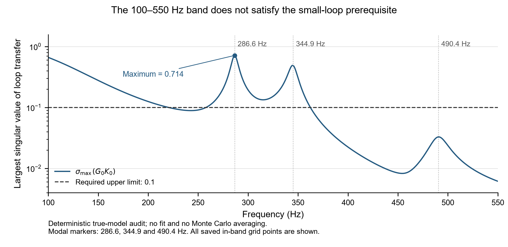
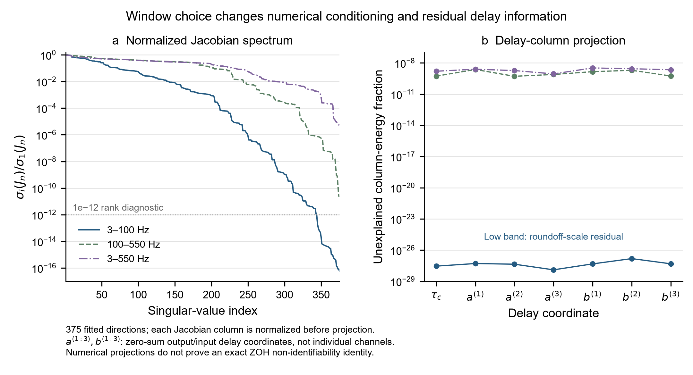

# 时延理论仿真验证报告

汇总时间：2026-10-21T09:48:49.983079+09:00。统一 QR/SVD 正式 MC 已保存 235/360 个端点，当前有效 0 个、失败 235 个、未完成 125 个。

**当前批次状态必须区分未完成和已完成但无法检验。** 尚未保存全部所需正式端点时，写“未完成，暂不能判定”；全部运行完成后仍因求根失败或信息不足而无法检验，才写“未通过（数值不可检验）”。成功子集均值不能当作总体无偏证据；数值不可检验也不等于理论被证伪。

## 1. 本轮范围、预设预测与计算约定

保留完整八模态、自由 C0/C1、自由 D0/D2、原逐模态瞬态和七个结构化时延，共375参数；真对象 C1=D0=D2=0。频带 L=3–100 Hz、H=100–550 Hz、W=3–550 Hz。所有八个极点均估计，包括目标频带外的718.958/755.501 Hz模态；没有通过冻结弱方向来降低难度。

原计划共360次：P=20时 M1 在 L/H/W 各40次；P=10/20/40时 M3 在 L/H 各40次。M1使用全部频点，M3使用激励谱线。每周期30000点、5kHz，先模拟两个稳定周期再保留P周期。数据种子1002+r，初值扰动种子100200+r；频率log扰动标准差0.01、阻尼log扰动标准差0.4。时延坐标从零偏移开始，公共初值200μs恰好是真公共时延，但相对时延未使用真值。本仿真已知局部分支，没有运行实测的41点公共时延网格；这限制了全局收敛结论。

**正式主统计统一且仅使用 `mc_qr_final/raw`。** 该路径无同名端点就标记未完成，绝不回退到正规方程、额外完整求根或试版 QR 路线。`mc/raw` 与 `mc/refinements` 只作原始数值失败诊断；`mc_qr/raw` 是计算求和顺序校验修改前启动即中止的试版，只列状态，不纳入正式统计。

正式版在线性剖面内层把QR/SVD的1e−13截断施加在原设计矩阵，而不是条件数已平方的正规矩阵上；内层收敛统一检查原始未压缩线性矩的score<1e−9。完整原375维矩的score<1e−6与贴边判据保持不变。旧内层2e−12在H频带过严，属于本次明确修复的数值求解容差，不能声称没有改动任何容差；它不是预先冻结的科学结论判据。正式外层仍包含剖面完整矩hybrid求根，而旧路径额外375维完整求根只是诊断，不是正式主估计。这一内层修复不代表外层Schur计算也已避免正规矩阵；第4节单列其新发现的数值瓶颈。

P2/P3的偏差比0.67–1.5、带外回路增益<0.1与2MCSE门槛不改变。P4仍要求P=40时偏差小于2MCSE并检查P=10/20/40趋势。P5原文未指定覆盖因子，另列1u/2u；不能把新选的覆盖因子冒称冻结判据。P1的秩1仿真MC不在当前360次安排中，不能据本轮称其已验证。

## 2. 新旧记录对齐核查

当前记录证据不支持用“新旧离线准备相差一拍”解释约196μs的有效公共时延差。新B组电机指令与控制器输出同拍且逐值相等；旧cl_data中U/Y/V与原始导出逐值相同；新旧控制器递推最早必要传感器输入均为一拍（200μs）。

ARX保留一拍输入时，独立半段相对残差约1e−11；删去一拍、只保留两拍及以后时恶化至约5e−5至3e−4。旧准备流程未发现移拍。这只验证记录信号边界，不是ADC/DAC或物理施力总时延标定；仍不能把局部模型有效时延直接解释为硬件时延。

完整证据与限制：[记录对齐核查](alignment/记录对齐核查.md)。

## 3. 回路条件与闭环稳定性

含已知输入/输出整数拍时延的闭环谱半径为 0.9980144722，稳定性检查为 True。

| 频带 | max σmax(GK) | 峰值频率/Hz | max谱半径(GK) | max单元素模 | 全带<0.1 |
| --- | --- | --- | --- | --- | --- |
| low_3_100 | 201.94 | 10.593 | 201.93 | 58.395 | False |
| high_100_550 | 0.71408 | 286.58 | 0.64922 | 0.48431 | False |
| wide_3_550 | 201.94 | 10.593 | 201.93 | 58.395 | False |

**H=100–550Hz并不满足带内回路增益小于0.1。** 最大奇异值约0.714，即使改用谱半径或最大元素模也超0.1。高频不能仅因在控制器标称带宽以外就当作开环极限。因此P2/P3的带外零偏差子预测在当前配置中缺少前提；不改控制器或截频段来使其看似满足。

图：已保存真模型回路审计的100–550 Hz全部频点，虚线为预设0.1上限；标出286.6、344.9、490.4 Hz模态。这里没有新增拟合或MC平均。矢量版：[PDF](figures/audit_high_band_loop_gain.pdf)。

## 4. 弱辨识与模型求值核查

下表为无噪声参考输入下、逐列归一化实雅可比的诊断，保留全部375列。Gram条件数会将雅可比条件数平方；在极弱方向上，直接形成Gram所得的微小负特征值属于数值精度问题，不能将其解释成负信息量。低频投影余量接近舍入误差，也不是精确ZOH结构恒等式的证明。

| 频带 | 归一化J条件数 | 由J推算Gram条件数 | J数值秩(1e−12) | 时延未解释能量最小 | 最大 |
| --- | --- | --- | --- | --- | --- |
| low_3_100 | 1.6853e+16 | 2.8402e+32 | 343 | 1.2529e-28 | 1.5051e-27 |
| high_100_550 | 4.5457e+10 | 2.0663e+21 | 375 | 5.152e-10 | 2.3138e-09 |
| wide_3_550 | 2.1607e+05 | 4.6686e+10 | 375 | 8.7968e-10 | 3.2699e-09 |

图：左为逐列归一化雅可比的奇异谱，右为时延列投影到其余参数列之外后剩余的能量比例。三个a与三个b坐标是零和相对时延的独立坐标，不是直接选四路中的前三路。该图是数值投影与条件性诊断；低频舍入量级余量不证明精确ZOH模型严格不可辨识，也不据此宣称全局不可辨识。矢量版：[PDF](figures/audit_band_information.pdf)。

补充数学边界说明：[时延一致性前提独立核查](audit/时延一致性前提独立核查.md)。

补充数学边界说明：[正式QR批次独立实现审计](audit/正式QR批次独立实现审计.md)。

| 核查项 | 结果 |
| --- | --- |
| 八模态传函与独立状态空间相对差 | 1.3901e-13 |
| 闭环 d→y 独立状态空间相对差 | 2.0193e-12 |
| 闭环 d→u 独立状态空间相对差 | 2.9043e-12 |
| 解析导数核查 | True |
| 无噪声谱残差相对量 | 1.111e-13 |
| 总体求值核查 | True |

这些是模型求值与导数核查，不是从任意初值恢复全部375真参数的证明。时延寄存器可引入不属于原模态瞬态空间的有限记录边界项；本核查先稳定两周期且无噪声周期重复，该误差在数值上可以忽略，但不能据此称任意初始状态或含噪边界上省略项严格为零。

### 外层求根的独立数值诊断

当前失败不能全部归因于弱辨识，更不能作为不存在IV根的证据。独立诊断发现，原高维设计在内层QR中保留的方向，会在外层正规Schur计算中再次被截断；弱的窗外模态随后产生异常大步长，共同缩放会把带内更新一并压低。下表是少数审计点，不是全部MC样本的原因统计。

| 频带 | 审计点 | tall设计秩/352 | Schur线性秩/352 | Schur非线性秩/23 | Schur条件数 | 共同步长因子 |
| --- | --- | --- | --- | --- | --- | --- |
| L | endpoint | 336 | 257 | 17 | 1.474e+15 | 0.012391 |
| H | endpoint | 352 | 332 | 19 | 1.8765e+15 | 5.1512e-06 |
| W | truth_profile | 352 | 352 | 23 | 1.0451e+08 | 0.0029743 |
| W | initial_profile | 352 | 352 | 23 | 3.5333e+08 | 0.00017366 |

H代表端点中，内层设计满秩352，而外层Schur线性块只保留332个方向；约755Hz的窗外模态阻尼产生约−7765的原始log步长，使共同步长因子缩至约5.15×10⁻⁶，带内频率的实际步长仅约10⁻⁸量级。W频带虽在这几个审计点未截掉线性方向，也出现窗外阻尼大步造成共同缩步。这是可具体定位的算法瓶颈，不是无根或不一致性的证明。

原始诊断：[Schur秩与步长核查](audit/schur_rank_check.json)。任何独立稳定求解器短试验仅作诊断，不改当前正式批次，也不混入主统计；本轮保留当前正式求解来源，现有成功门槛和未完成语义保持不变。

### 稳定投影与信赖域短试验：仅作数值诊断

独立短试验将外层正规Schur改为投影构造并使用信赖域，随后对H做完整中央差分矩收尾。模型、375维原矩验收门槛、窗外模态及贴边判据均保留。下列是同一或少数数据样本上的不同尝试，不是独立Monte Carlo样本；所有尝试都保留，也不把其中最小score的结果回填到正式批次。

| 独立短试验 | 完整375维score | 内层score | 通过原门槛 | 贴边 | 求解/全部profile次数 | 秒 | 退出状态 |
| --- | --- | --- | --- | --- | --- | --- | --- |
| central_P10_r000_H_M3 | 4.4351e-06 | 3.1674e-10 | False | False | 150/162 | 399.9 | total_profile_call_limit |
| v1_P10_r000_H_M3 | 1.8499e-05 | 2.8846e-10 | False | False | 12/12 | 51.142 | trf_finished |
| v1_P20_r000_W_M1 | 0.0013743 | 1.5869e-12 | False | False | 8/8 | 410.15 | wall_time_limit |
| v2_P10_r000_H_M3 | 6.8077e-06 | 1.8745e-10 | False | False | 40/40 | 172.1 | trf_finished |

H的score从约0.373降至投影40步后的6.8077×10⁻⁶，再经完整矩收尾降至4.4351×10⁻⁶；W的终值约0.0013743。它们均未达到原1×10⁻⁶门槛，全部继续按失败诊断保存。改善表明原停滞包含实际数值机制；仍不能据此称已求得有效根、已验证一致性，或认为全部模态都无法准确估计。

H的带内模态单独列出如下。误差是相对真值的百分比，阻尼使用exp−1换算，不是阻尼比百分点。带内小误差不能替代全参数验收，也不能作为跨样本精度统计。

| 短试验 | 模态真值/Hz | 频率误差/% | 阻尼误差/% |
| --- | --- | --- | --- |
| central_P10_r000_H_M3 | 286.573 | 0.0001885 | 0.0099529 |
| central_P10_r000_H_M3 | 344.945 | -0.00010562 | -0.0048746 |
| central_P10_r000_H_M3 | 490.39 | -0.00025267 | -0.035727 |
| v2_P10_r000_H_M3 | 286.573 | 0.00018914 | 0.0099157 |
| v2_P10_r000_H_M3 | 344.945 | -0.00010711 | -0.0049154 |
| v2_P10_r000_H_M3 | 490.39 | -0.00025143 | -0.0369 |

独立v2端点审计的最大10个score方向均涉及窗外第7/8模态或时延；因此“完整375参数未过门槛”与“带内三个模态拟合较好”可以同时成立。该审计只针对v2端点，不能自动推广到所有失败样本。详情：[端点方向核查](audit/stable_endpoint_check.json)；[全部数值修复短试验与预算](stable_profile_pilot/数值修复pilot说明.md)。

**本轮不切换正式来源，也不启动新的MC路线。** 当前统一批次仍以`mc_qr_final/raw`为唯一来源并继续保留全部失败。独立短试验不计入360项完成度。正式批次未完成时P4仍暂不能判定；即使最终全部数值失败，也只能给出“未通过（数值不可检验）”，不能作为一致性理论的反证。

## 5. Monte Carlo 完成度与全部失败

| P | 频带 | 方法 | 正式保存 | 正式有效 | 正式失败 | 未完成 | 正规方程诊断保存/成功 | 额外root诊断保存/成功 | 中止QR试版 |
| --- | --- | --- | --- | --- | --- | --- | --- | --- | --- |
| 20 | L | M1 | 32 | 0 | 32 | 8 | 3/0 | 0/0 | 0 |
| 20 | H | M1 | 31 | 0 | 31 | 9 | 3/0 | 0/0 | 0 |
| 20 | W | M1 | 28 | 0 | 28 | 12 | 0/0 | 0/0 | 0 |
| 10 | L | M3 | 40 | 0 | 40 | 0 | 40/0 | 4/0 | 4 |
| 10 | H | M3 | 40 | 0 | 40 | 0 | 40/0 | 0/0 | 0 |
| 20 | L | M3 | 32 | 0 | 32 | 8 | 3/0 | 0/0 | 0 |
| 20 | H | M3 | 32 | 0 | 32 | 8 | 3/0 | 0/0 | 0 |
| 40 | L | M3 | 0 | 0 | 0 | 40 | 0/0 | 0/0 | 0 |
| 40 | H | M3 | 0 | 0 | 0 | 40 | 0/0 | 0/0 | 0 |

正式统计只取统一 `mc_qr_final/raw`。所有失败的端点、score、状态、边界及诊断路线状态都保存在`analysis/mc_endpoint_inventory.csv`，不删除异常值。下面的均值、SD、RMSE只使用通过求解的子集，明确不是无条件总体性能；若失败与数据相关，会产生选择效应。

## 6. 时延估计结果与 P4

| P | 频带 | 方法 | 有效统计n/40 | 公共时延偏差/μs | MCSE/μs | SD/μs | RMSE/μs |
| --- | --- | --- | --- | --- | --- | --- | --- |
| 20 | L | M1 | 0/40 | — | — | — | — |
| 20 | H | M1 | 0/40 | — | — | — | — |
| 20 | W | M1 | 0/40 | — | — | — | — |
| 10 | L | M3 | 0/40 | — | — | — | — |
| 10 | H | M3 | 0/40 | — | — | — | — |
| 20 | L | M3 | 0/40 | — | — | — | — |
| 20 | H | M3 | 0/40 | — | — | — | — |
| 40 | L | M3 | 0/40 | — | — | — | — |
| 40 | H | M3 | 0/40 | — | — | — | — |

公共时延真值为200μs，输出相对时延为[100,−100,100,−100]μs，输入相对时延为[−100,100,−100,100]μs。公共及八个零和相对分量共七独立方向；下表九行分量不是九个独立检验。

| 频带 | 时延分量 | n(P10/P20/P40) | 偏差P10 | 偏差P20 | 偏差P40 | 2MCSE(P40) | 判定 |
| --- | --- | --- | --- | --- | --- | --- | --- |
| L | common | 0/0/0 | — | — | — | — | 未完成，暂不能判定 |
| L | output1 | 0/0/0 | — | — | — | — | 未完成，暂不能判定 |
| L | output2 | 0/0/0 | — | — | — | — | 未完成，暂不能判定 |
| L | output3 | 0/0/0 | — | — | — | — | 未完成，暂不能判定 |
| L | output4 | 0/0/0 | — | — | — | — | 未完成，暂不能判定 |
| L | input1 | 0/0/0 | — | — | — | — | 未完成，暂不能判定 |
| L | input2 | 0/0/0 | — | — | — | — | 未完成，暂不能判定 |
| L | input3 | 0/0/0 | — | — | — | — | 未完成，暂不能判定 |
| L | input4 | 0/0/0 | — | — | — | — | 未完成，暂不能判定 |
| H | common | 0/0/0 | — | — | — | — | 未完成，暂不能判定 |
| H | output1 | 0/0/0 | — | — | — | — | 未完成，暂不能判定 |
| H | output2 | 0/0/0 | — | — | — | — | 未完成，暂不能判定 |
| H | output3 | 0/0/0 | — | — | — | — | 未完成，暂不能判定 |
| H | output4 | 0/0/0 | — | — | — | — | 未完成，暂不能判定 |
| H | input1 | 0/0/0 | — | — | — | — | 未完成，暂不能判定 |
| H | input2 | 0/0/0 | — | — | — | — | 未完成，暂不能判定 |
| H | input3 | 0/0/0 | — | — | — | — | 未完成，暂不能判定 |
| H | input4 | 0/0/0 | — | — | — | — | 未完成，暂不能判定 |

上表判定保留P40的2MCSE数值门槛；P10/P20/P40偏差趋势另列作描述性检查，不事后增设MC均值严格单调的通过条件。对应频带的P10/P20/P40正式MC尚未全部保存时，主判定一律是“未完成，暂不能判定”。全部保存后仍缺乏可靠数值端点才记为“未通过（数值不可检验）”，不能称为一致性理论被证伪。成功子集的条件性2MCSE门槛另存CSV，不能掩盖失败。

## 7. 模态频率、阻尼及偏差传播

全部频率/阻尼误差按100×expm1(估计log参数−真log参数)计算，不与log单位混用。完整八模态频率与阻尼正式统计在 `analysis/mc_statistics.csv`；诊断路线的端点误差仅保留于inventory，不参与该统计。

| P | 频带 | 方法 | 模态/Hz | 有效n | 阻尼偏差/% | MCSE | SD | RMSE |
| --- | --- | --- | --- | --- | --- | --- | --- | --- |
| 20 | L | M1 | 10.6 | 0 | — | — | — | — |
| 20 | L | M1 | 11.7 | 0 | — | — | — | — |
| 20 | L | M1 | 16.1 | 0 | — | — | — | — |
| 20 | L | M1 | 286.573 | 0 | — | — | — | — |
| 20 | L | M1 | 344.945 | 0 | — | — | — | — |
| 20 | L | M1 | 490.39 | 0 | — | — | — | — |
| 20 | L | M1 | 718.958 | 0 | — | — | — | — |
| 20 | L | M1 | 755.501 | 0 | — | — | — | — |
| 20 | H | M1 | 10.6 | 0 | — | — | — | — |
| 20 | H | M1 | 11.7 | 0 | — | — | — | — |
| 20 | H | M1 | 16.1 | 0 | — | — | — | — |
| 20 | H | M1 | 286.573 | 0 | — | — | — | — |
| 20 | H | M1 | 344.945 | 0 | — | — | — | — |
| 20 | H | M1 | 490.39 | 0 | — | — | — | — |
| 20 | H | M1 | 718.958 | 0 | — | — | — | — |
| 20 | H | M1 | 755.501 | 0 | — | — | — | — |
| 20 | W | M1 | 10.6 | 0 | — | — | — | — |
| 20 | W | M1 | 11.7 | 0 | — | — | — | — |
| 20 | W | M1 | 16.1 | 0 | — | — | — | — |
| 20 | W | M1 | 286.573 | 0 | — | — | — | — |
| 20 | W | M1 | 344.945 | 0 | — | — | — | — |
| 20 | W | M1 | 490.39 | 0 | — | — | — | — |
| 20 | W | M1 | 718.958 | 0 | — | — | — | — |
| 20 | W | M1 | 755.501 | 0 | — | — | — | — |
| 10 | L | M3 | 10.6 | 0 | — | — | — | — |
| 10 | L | M3 | 11.7 | 0 | — | — | — | — |
| 10 | L | M3 | 16.1 | 0 | — | — | — | — |
| 10 | L | M3 | 286.573 | 0 | — | — | — | — |
| 10 | L | M3 | 344.945 | 0 | — | — | — | — |
| 10 | L | M3 | 490.39 | 0 | — | — | — | — |
| 10 | L | M3 | 718.958 | 0 | — | — | — | — |
| 10 | L | M3 | 755.501 | 0 | — | — | — | — |
| 10 | H | M3 | 10.6 | 0 | — | — | — | — |
| 10 | H | M3 | 11.7 | 0 | — | — | — | — |
| 10 | H | M3 | 16.1 | 0 | — | — | — | — |
| 10 | H | M3 | 286.573 | 0 | — | — | — | — |
| 10 | H | M3 | 344.945 | 0 | — | — | — | — |
| 10 | H | M3 | 490.39 | 0 | — | — | — | — |
| 10 | H | M3 | 718.958 | 0 | — | — | — | — |
| 10 | H | M3 | 755.501 | 0 | — | — | — | — |
| 20 | L | M3 | 10.6 | 0 | — | — | — | — |
| 20 | L | M3 | 11.7 | 0 | — | — | — | — |
| 20 | L | M3 | 16.1 | 0 | — | — | — | — |
| 20 | L | M3 | 286.573 | 0 | — | — | — | — |
| 20 | L | M3 | 344.945 | 0 | — | — | — | — |
| 20 | L | M3 | 490.39 | 0 | — | — | — | — |
| 20 | L | M3 | 718.958 | 0 | — | — | — | — |
| 20 | L | M3 | 755.501 | 0 | — | — | — | — |
| 20 | H | M3 | 10.6 | 0 | — | — | — | — |
| 20 | H | M3 | 11.7 | 0 | — | — | — | — |
| 20 | H | M3 | 16.1 | 0 | — | — | — | — |
| 20 | H | M3 | 286.573 | 0 | — | — | — | — |
| 20 | H | M3 | 344.945 | 0 | — | — | — | — |
| 20 | H | M3 | 490.39 | 0 | — | — | — | — |
| 20 | H | M3 | 718.958 | 0 | — | — | — | — |
| 20 | H | M3 | 755.501 | 0 | — | — | — | — |
| 40 | L | M3 | 10.6 | 0 | — | — | — | — |
| 40 | L | M3 | 11.7 | 0 | — | — | — | — |
| 40 | L | M3 | 16.1 | 0 | — | — | — | — |
| 40 | L | M3 | 286.573 | 0 | — | — | — | — |
| 40 | L | M3 | 344.945 | 0 | — | — | — | — |
| 40 | L | M3 | 490.39 | 0 | — | — | — | — |
| 40 | L | M3 | 718.958 | 0 | — | — | — | — |
| 40 | L | M3 | 755.501 | 0 | — | — | — | — |
| 40 | H | M3 | 10.6 | 0 | — | — | — | — |
| 40 | H | M3 | 11.7 | 0 | — | — | — | — |
| 40 | H | M3 | 16.1 | 0 | — | — | — | — |
| 40 | H | M3 | 286.573 | 0 | — | — | — | — |
| 40 | H | M3 | 344.945 | 0 | — | — | — | — |
| 40 | H | M3 | 490.39 | 0 | — | — | — | — |
| 40 | H | M3 | 718.958 | 0 | — | — | — | — |
| 40 | H | M3 | 755.501 | 0 | — | — | — | — |

高频目标为286.573/344.945/490.390Hz。P3需要把自身/其他耦合项和共享时延传播项分开；当前H窗口回路并不小，不能预先把自身项置零，再把所有偏差归因于共享时延。

## 8. P2/P3总体偏差计算与可检验性

**P2/P3所需M1正式MC目前保存 91/120，比较仍待完成。** 此时不对MC偏差比或2MCSE作通过/未通过判定。第3节的高频小回路前提不满足是独立完成的条件核查，不依赖这批MC是否跑完。

| 积分步长/Hz | 频带 | rcond | 秩/375 | 公共τ预测/μs | 完整/Schur差/μs | 因子Schur可算 | 因子公共τ/μs | 最大线性相位/rad |
| --- | --- | --- | --- | --- | --- | --- | --- | --- |
| 0.083333 | L | 1e-10 | 230 | 39.796 | 851.58 | False | — | — |
| 0.083333 | L | 1e-12 | 249 | -151.78 | 903.84 | False | — | — |
| 0.083333 | L | 1e-14 | 267 | 610.38 | 5148 | False | — | — |
| 0.083333 | L | 1e-16 | 288 | 50971 | 1.7432e+05 | False | — | — |
| 0.083333 | H | 1e-10 | 325 | -3.3129 | 17.872 | False | — | — |
| 0.083333 | H | 1e-12 | 332 | -3.1272 | 6.2388 | False | — | — |
| 0.083333 | H | 1e-14 | 352 | -5.1075 | 9.1394 | False | — | — |
| 0.083333 | H | 1e-16 | 369 | -5.7166 | 10.268 | False | — | — |
| 0.083333 | W | 1e-10 | 369 | 649.29 | 10931 | True | 5677.6 | 48.461 |
| 0.083333 | W | 1e-12 | 375 | 5677.6 | 41107 | True | 5677.6 | 48.461 |
| 0.083333 | W | 1e-14 | 375 | 5677.6 | 41107 | True | 5677.6 | 48.461 |
| 0.083333 | W | 1e-16 | 375 | 5677.6 | 41107 | True | 5677.6 | 48.461 |
| 0.16667 | L | 1e-10 | 230 | 39.794 | 3817.1 | False | — | — |
| 0.16667 | L | 1e-12 | 249 | -151.71 | 904.18 | False | — | — |
| 0.16667 | L | 1e-14 | 267 | 590.34 | 5207.6 | False | — | — |
| 0.16667 | L | 1e-16 | 286 | 3803.6 | 42990 | False | — | — |
| 0.16667 | H | 1e-10 | 325 | -3.3129 | 16.347 | False | — | — |
| 0.16667 | H | 1e-12 | 332 | -3.1275 | 8.548 | False | — | — |
| 0.16667 | H | 1e-14 | 352 | -5.1077 | 9.2052 | False | — | — |
| 0.16667 | H | 1e-16 | 368 | -5.7431 | 10.309 | False | — | — |
| 0.16667 | W | 1e-10 | 369 | 649.15 | 10742 | True | 5676.9 | 48.455 |
| 0.16667 | W | 1e-12 | 375 | 5676.9 | 19913 | True | 5676.9 | 48.455 |
| 0.16667 | W | 1e-14 | 375 | 5676.9 | 19913 | True | 5676.9 | 48.455 |
| 0.16667 | W | 1e-16 | 375 | 5676.9 | 19913 | True | 5676.9 | 48.455 |

表中全部截断选择均保留。伪逆分别截断全矩阵与Schur子块未必对应同一解；若预测随截断/积分变化很大，或线性化相位改变量不小，不能选一个有利值套入0.67–1.5偏差比。计算方法与逐项诊断见 [总体偏差计算说明](analysis/predictions.md)。

当前不得把“完成矩阵运算”等同于“得到可靠的一阶预测”。是否满足局部展开、稳定数值秩和足够成功MC样本必须与偏差比一起检查。高频零偏差的<0.1回路前提已确认不满足，这与MC统计门槛是否可算是两个不同问题。

## 9. P5：既有实测相对时延

现有实测数据不支持 P5：秩1共享振型模型的相对时延跨窗口不一致；1u与2u两种描述性尺度下均如此。

| 模型 | 分量 | 比较数 | 1u内 | 2u内 | 扣噪1u内 | 扣噪2u内 |
| --- | --- | --- | --- | --- | --- | --- |
| a | output | 24 | 4 | 6 | 4 | 5 |
| a | input | 24 | 7 | 9 | 7 | 9 |
| a | all | 48 | 11 | 15 | 11 | 14 |
| b | output | 24 | 0 | 0 | 0 | 0 |
| b | input | 24 | 1 | 3 | 1 | 3 |
| b | all | 48 | 1 | 3 | 1 | 3 |

P5完全排除公共时延。两个窗口的相同删周期折内先做差再计算JK；运行间复现性由三个控制器各自A/C重复差合并，保留跨窗口相关性。1u/2u均不支持秩1模型跨窗口一致，扣除重复计入统计噪声也不改变判断。48是逐分量比较数，非48个独立检验。

完整推导与源文件复核：[P5核查报告](p5/P5_相对时延跨窗口核查.md)。

## 10. 当前可写与不可写

- 可报告：新旧记录时序核查、稳定性和回路条件、信息矩阵病态性、P5现有数据不支持，以及实际保存的MC成功/失败数量。
- 不可把未完成MC写成完成；不可把成功子集的低偏差写成总体无偏；不可把带外小回路条件不成立时的结果当作相应推论的反例。
- 本轮自由留数375参数的弱辨识可能阻止直接检验预定时延偏差命题。保持全部原条件与失败，不通过缩模型、固定弱参数或改噪声来凑结论。
- 参考IV的一致性是正确模型、充分激励、可辨识与找到真值附近根下的条件性结果，本轮求值核查和实测相容性检查都不能替代这些条件。

## 11. 输出与更新

`code/summarize.py` 不导入拟合器，仅聚合已有文件。每次统一正式MC完成更多样本后可重新运行，覆盖本目录汇总，不改原始数据与端点。机器可读状态为 `analysis/report_summary.json`；全360计划索引、正式主统计与P4分量表均在 `analysis/`；诊断路线只作单列，不混入主统计。

`code/watch_run.py` 是当前有限MC批次的伴随进程，每新增8个正式端点自动重建报告；批次进程退出时再重建一次并核验原文件哈希，输出 `analysis/source_hash_verification.json`。`RUN_STATUS.json` 提供实时数量、是否仍运行与 complete 标志；本报告是生成时快照。

本次读取的运行状态：running=False，complete=False，更新时间=2026-10-21T09:48:48.152396。complete=false 时不得宣称本批次全部完成。

运行中原文件审计：已核对 8143/8143 个文件，改变 0、缺失 0、读取错误 0。这是运行中快照，不是批次结束后的最终审计；最终哈希核查仍由监看进程在退出时执行。详情：[运行中哈希核查](analysis/source_hash_during_batch.json)。
