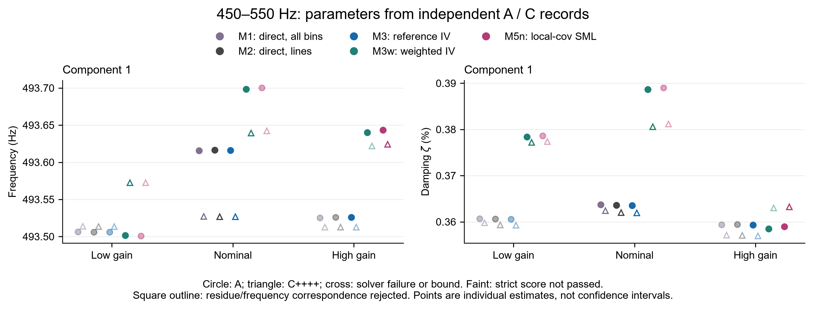
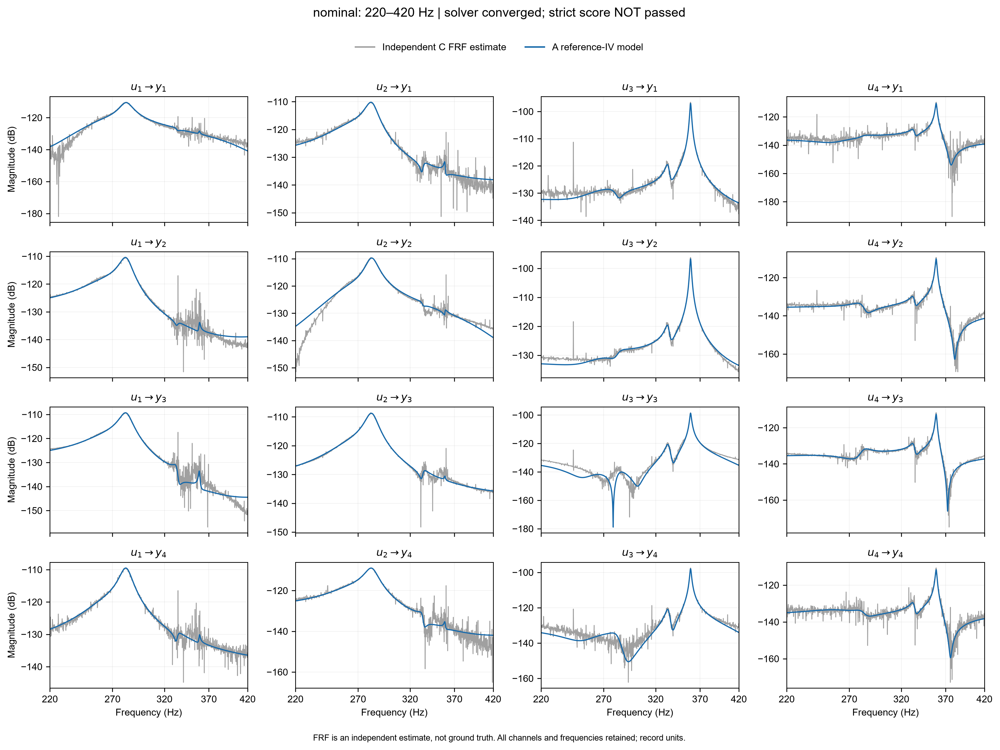
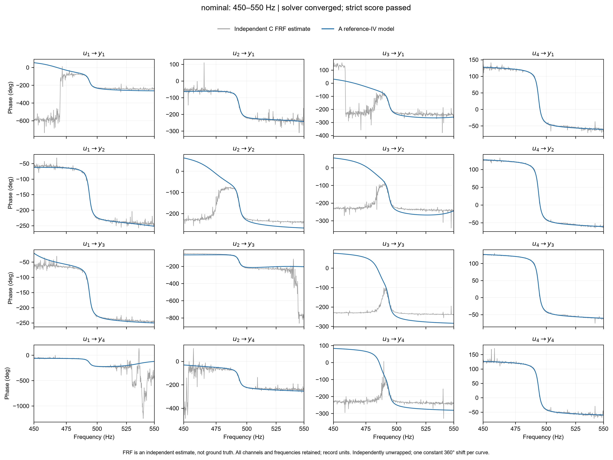
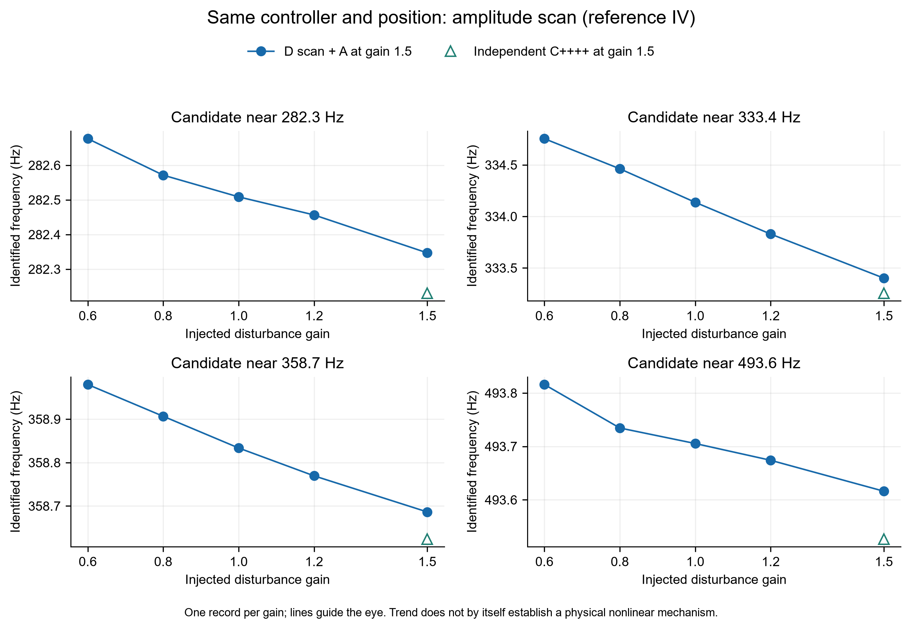

# 高频实测模态验证：参考IV、直接法与加权方法

2026-10-20。使用本批新采A–E实验中的真实记录，完成 **120组固定协议高频主估计、61组数值精度续算、8组D幅值诊断**。没有改动原始MAT、原低频估计数组或理论文档；收尾时一次父报告重生成例外见第8节。

## 1. 实际结论

应把高频模态纳入论文，而且这次已经做了参数辨识。但结果**不能写成“高频已全部验证一致”**：约282、333、359、493 Hz的候选能被追踪，频率变化较小，阻尼更敏感；按仅含B噪声的条件不确定度检查，跨控制器相容性仍未通过。650–800 Hz密集区的当前局部模型没有得到可用的完整辨识结果。

在约493 Hz，直接法与参考IV估计几乎相同；加权IV与邻点SML也彼此接近，但二者没有改善独立C记录的未加权复输出预测，反而增大误差。此结果不支持“加权一定更好”。它也不否定正确模型条件下的理论，因为当前局部模型、跨运行稳定性和噪声等价假设尚未全部成立。

附加D检查发现：同一nominal控制器、同一z=0位置，估计频率也随注入幅值变化。故不能将换控制器后的所有参数变化都解释为闭环估计偏差；也不能仅凭该趋势认定某个机械非线性机理。

## 2. 记录、模型和公平对照

主估计为A组三个控制器与各自C++++独立重复，共6条记录；B组用于条件噪声谱；每个控制器C四符号实验构成独立FRF参照。沿用父任务的时间对齐、注入门控、舍弃首周期与采样单位。fs=5000 Hz，每周期30000点。此处未将不同位置E组混入“同对象换控制器”判据，未重复计数与A nominal相同的D 1.5文件。

采用预先固定的**局部分频段加性模态模型**。它不是完整3–800 Hz联合辨识，也没有沿用低频3模态直接外推到高频：

\[
G_{oi}(z)=e^{-j\omega\tau_{oi}}\left[\sum_{r=1}^m\big(C^{(0)}_{oir}H^{\mathrm{ZOH}}_{0r}(z)+C^{(1)}_{oir}H^{\mathrm{ZOH}}_{1r}(z)\big)+D_{0,oi}+D_{2,oi}(j\omega/\omega_{\mathrm{ref}})^2\right].
\]

其中H0、H1分别为连续传函ωr²/(s²+2ζrωrs+ωr²)和ωrs/(s²+2ζrωrs+ωr²)的精确ZOH值。背景缩放ωref=2πf上限，与求和的模态ωr不同。固定τ沿用父模型已减100µs的数组，本轮不重新估计时延。每个模态/输出还有独立瞬态(t0+t1 z⁻¹)/ar(z⁻¹)。模态用logω、logζ坐标，百分比差统一按100[exp(δlog)−1]。

每模态有32个实C0/C1系数、8个瞬态系数、2个极点参数，另有32个D0/D2系数；总参数42m+32。局部D0/D2只近似带外动态，并不保证能刻画其复相位背景。m和边界均在看方法效果前固定。

| 窗口 | 频带/Hz | 分量数/参数数 | 初始频率/Hz | 说明 |
| --- | --- | --- | --- | --- |
| H100 | [90, 190] | 2/116 | 129.0, 136.0 | 来源待定 |
| H300 | [220, 420] | 4/200 | 263.0, 282.0, 340.0, 360.0 | 首项宽背景，不视为机械模态 |
| H493 | [450, 550] | 1/74 | 493.0 | 柔性候选 |
| H700 | [620, 800] | 5/242 | 669.0, 679.0, 682.0, 706.0, 778.0 | 柔性候选 |

M1用全部DFT频点的实测输入工具，M2只用激励谱线，M3用谱线参考工具Û=(I+KG)⁻¹D；M3w在M3之后用16个邻近非激励频点估计完整4×4残差协方差，0.1对角收缩、一次权更新；M5n用同一邻点样本的联合U/Y协方差求模型依赖加权SML。没有LRM，也没有把FRF拟合伪称原始谱IV。

各方法同一模型、极点种子和边界。线性系数按各自使用的数据OLS初始化；因此M1的线性初值不与谱线方法逐元素相同。M3w按定义从M3解启动，SML从共同谱线OLS启动。IV最多80步、模态原始步阈值1e−5，并另查全参数归一化score<1e−6；SML最多160次函数评估、带边界TRF。详细规则和全部边界见PLAN.md。M5n的迭代计数是函数评估数，不与IV迭代耗时混为一谈。

## 3. 参考IV实际识别出的频率、阻尼

下表是A记录M3原协议端点，括号为ζ（%），不是对真值的误差。约263 Hz宽背景和未收敛H700不放入“可追踪机械候选”表，但全部端点在原始结果与参数CSV保留。以下“候选”不是板本体归属证明；特别132/134 Hz来源待定。

| 候选 | lowgain f(ζ) | nominal f(ζ) | highgain f(ζ) | 频率极差/Hz | 阻尼极差/百分点 |
| --- | --- | --- | --- | --- | --- |
| H100/1 | 132.2294 (0.7211) | 132.1187 (0.5814) | 131.8603 (0.6465) | 0.3691 | 0.1398 |
| H100/2 | 134.2165 (1.1455) | 134.2828 (1.0653) | 134.2018 (1.1107) | 0.0810 | 0.0801 |
| H300/2 | 282.2359 (2.0113) | 282.3471 (1.9669) | 282.2367 (2.0191) | 0.1112 | 0.0522 |
| H300/3 | 333.2911 (0.6885) | 333.4014 (0.7267) | 333.6727 (0.6378) | 0.3816 | 0.0889 |
| H300/4 | 358.6496 (0.2573) | 358.6864 (0.2513) | 358.6840 (0.2471) | 0.0368 | 0.0102 |
| H493/1 | 493.5059 (0.3606) | 493.6161 (0.3635) | 493.5260 (0.3593) | 0.1102 | 0.0042 |

相同记录内M1与M3的绝对相对差如下。这里分母是M3估计，**不是准确度或偏差真值**；不能把高于100 Hz当成反馈相关噪声严格消失的界线。

| 候选 | \|f_M1/f_M3−1\|/%范围 | \|ζ_M1/ζ_M3−1\|/%范围 |
| --- | --- | --- |
| H100/1 | 0.00474–0.03337 | 0.665–12.432 |
| H100/2 | 0.00888–0.03481 | 1.713–4.251 |
| H300/2 | 0.00041–0.00117 | 0.001–0.060 |
| H300/3 | 0.00002–0.00574 | 0.121–0.243 |
| H300/4 | 0.00015–0.00137 | 0.101–0.372 |
| H493/1 | 0.00007–0.00016 | 0.021–0.052 |

圆点为A，三角为独立C++++；叉号为数值失败或贴边；淡色表示未过严格score。所有方法、记录都保留。H100/H300/H700另有对应参数图。

## 4. 数值失败、精度诊断与跨控制器检查

每行6条记录。数值停止成功、严格score通过、未贴边是三个不同条件。SML在边界的优化成功不能当作可靠模态。

| 窗口 | 方法 | 求解失败/6 | 贴边/6 | score未过/6 | 中位耗时/s |
| --- | --- | --- | --- | --- | --- |
| H100 | M1 | 0 | 0 | 0 | 1.87 |
| H100 | M2 | 0 | 0 | 0 | 0.17 |
| H100 | M3 | 0 | 0 | 0 | 0.30 |
| H100 | M3w | 6 | 4 | 6 | 0.77 |
| H100 | M5n | 0 | 5 | 6 | 3.03 |
| H300 | M1 | 0 | 0 | 1 | 6.18 |
| H300 | M2 | 0 | 0 | 4 | 0.55 |
| H300 | M3 | 0 | 0 | 4 | 0.92 |
| H300 | M3w | 5 | 2 | 6 | 2.25 |
| H300 | M5n | 0 | 1 | 6 | 12.68 |
| H493 | M1 | 0 | 0 | 4 | 0.14 |
| H493 | M2 | 0 | 0 | 4 | 0.02 |
| H493 | M3 | 0 | 0 | 3 | 0.03 |
| H493 | M3w | 0 | 0 | 1 | 0.10 |
| H493 | M5n | 0 | 0 | 4 | 0.40 |
| H700 | M1 | 6 | 3 | 6 | 13.79 |
| H700 | M2 | 6 | 3 | 6 | 1.19 |
| H700 | M3 | 6 | 3 | 6 | 1.86 |
| H700 | M3w | 6 | 6 | 6 | 0.32 |
| H700 | M5n | 6 | 6 | 6 | 61.30 |

主协议共120次，41次求解失败，33次贴边，79次严格score未过；三个计数允许重叠，不可相加作总失败数。所有异常与端点均在raw目录，程序异常为0次。H700五方法×六记录共30次均未收敛。

为区分停止过早与实质失败，另对前三窗口中已收敛且未贴边的61个IV端点续算，目标score<1e−8，最多25步，不改权重、模型、边界。原端点保留，续算单放diagnostics，未用此过程替换主协议的失败计数。

| 窗口 | 续算数量 | 原score通过 | 续算后通过 | 最大频率改变量/Hz | 最大ζ改变量/百分点 |
| --- | --- | --- | --- | --- | --- |
| H100 | 18 | 18 | 18 | 7.12e-06 | 1.05e-05 |
| H300 | 19 | 9 | 19 | 6.2e-05 | 0.000215 |
| H493 | 24 | 12 | 24 | 7.45e-06 | 5.02e-07 |

61/61续算端点通过严格score，改变很小。这说明不少原score未通过只是停止标准过松；不能据此否定所有已收敛的高频极点。反过来，H100/H300加权方案的贴边和H700失败不能由这个结果消除。

条件不确定度保留全部线性/瞬态干扰参数，以参考工具雅可比Z和各自权W计算M=ReΣZᴴWZ，Q=(1/2)ReΣZᴴW(NΦB)WZ，Cov=M⁻¹QM⁻ᵀ，再由log坐标换算f和ζ的标准不确定度u。ΦB来自独立B记录的5邻点/周期残差谱和0.1收缩。使用N是全长未归一化DFT的方差尺度；正频率复数据取实矩时有1/2。

这是假设局部模型正确、B噪声可代表激励工况、频线近似独立时的代入值，不含模型失配、时延误差、幅值依赖、运行漂移，M3w还冻结估计权。不能称为已标定的实验总不确定度或自动95%置信区间。

续算后用相同条件u重检；只计数值合格、非背景、频率差<10%且复留数MAC≥0.7的配对，每候选3控制器对×2参数：

| 窗口 | 方法 | 可检查配对数 | 满足\|Δ\|<2合成u |
| --- | --- | --- | --- |
| H100 | M3 | 12 | 0 |
| H300 | M3 | 18 | 1 |
| H493 | M3 | 6 | 0 |
| H493 | M3w | 6 | 0 |

约493Hz参考IV的f标准不确定度仅约0.00047–0.00063 Hz，而跨控制器频差约0.020–0.110 Hz，独立nominal A/C频差也约0.090 Hz。即使数值根精化，相容性仍未通过。这个结果应解释为“当前条件噪声u不足以解释运行间变化”，不能直接推出参考IV理论错误或某方法一定更准。

## 5. 独立C参照与复残差

A模型完全不使用C输出拟合。对C四次符号激励，逐谱线G_C=Y_C U_C⁻¹作为参照，不做LRM、平滑或求逆正则化；FRF不是真值。另外直接检查Y_C−G_A U_C，避免把U_C求逆病态完全传给评价。两个指标均用全4×4复数数组的Frobenius范数按频带聚合。测试端不重新拟合瞬态，残差可能含残余有限记录瞬态；不以A记录瞬态代入C。

以下重点表中，每格为“复FRF相对差 / 不经输入求逆的C输出残差”（%）。全部窗口、方法60行在FRF_validation.csv，包括失败模型端点，不能删去后只报好结果。

| 窗口 | 控制器 | M1 | M2 | M3 | M3w | M5n |
| --- | --- | --- | --- | --- | --- | --- |
| H300 | lowgain | 19.08 / 9.31 | 19.15 / 9.37 | 19.15 / 9.38 | 20.34 / 12.25 | 20.33 / 12.22 |
| H300 | nominal | 11.11 / 6.45 | 11.11 / 6.46 | 11.09 / 6.45 | 12.81 / 10.78 | 13.30 / 10.50 |
| H300 | highgain | 11.62 / 6.30 | 11.62 / 6.30 | 11.64 / 6.31 | 13.69 / 9.14 | 13.78 / 9.23 |
| H493 | lowgain | 25.30 / 7.95 | 25.29 / 7.94 | 25.29 / 7.94 | 27.30 / 12.98 | 27.31 / 12.99 |
| H493 | nominal | 9.90 / 8.19 | 9.90 / 8.19 | 9.90 / 8.19 | 13.37 / 12.35 | 13.42 / 12.40 |
| H493 | highgain | 8.59 / 7.58 | 8.59 / 7.58 | 8.58 / 7.58 | 12.98 / 12.77 | 13.02 / 12.82 |

在这些窗口，M1/M2/M3的独立预测很接近；加权IV/邻点SML的未加权预测残差更大。这仅说明当前“局部模型+该噪声权”的组合未得到净收益，不能据此否定SML或最优IV的一般效率结果。失配模型下，不同权重会选择不同近似解；有限邻点协方差和频线相关性也可能参与，目前未唯一分离两者。

全部三控制器×四窗口均给出4×4幅值、连续相位和复残差图，共36张，另有4张参数图及1张幅值扫描图。相位对数据和模型各自unwrap，只做整条曲线的360°整数偏移；低幅值处FRF可发生噪声绕圈，没有逐点贴齐模型来美化。复残差图的绿色曲线是C前后段之差，包含漂移和求逆影响，不称纯噪声底。未收敛模型的图在标题明确标识。

## 6. 同控制器D幅值对照

这是主协议结束后的次要诊断：增加D的0.6/0.8/1.0/1.2四个幅值，只跑相同H300/H493参考IV，共8次；1.5直接引用A nominal，避免重复计数。没有换模型、初值或参数边界，也没有用它替换120次主对照。

| 注入系数 | 约282Hz f(ζ) | 约334Hz f(ζ) | 约359Hz f(ζ) | 约493Hz f(ζ) |
| --- | --- | --- | --- | --- |
| 0.6 | 282.6767 (1.9572) | 334.7546 (0.5787) | 358.9798 (0.2459) | 493.8159 (0.3654) |
| 0.8 | 282.5714 (1.9710) | 334.4624 (0.6354) | 358.9067 (0.2461) | 493.7345 (0.3641) |
| 1.0 | 282.5088 (1.9679) | 334.1370 (0.6699) | 358.8337 (0.2491) | 493.7054 (0.3669) |
| 1.2 | 282.4565 (1.9680) | 333.8290 (0.7011) | 358.7695 (0.2502) | 493.6740 (0.3649) |
| 1.5 | 282.3471 (1.9669) | 333.4014 (0.7267) | 358.6864 (0.2513) | 493.6161 (0.3635) |

8次诊断均达到原求解停止条件、无贴边；其中H300的0.8/1.0/1.2三个原score略高于1e−6，保留标记，不混入主精化计数。约493Hz四个D解均通过严格score。

例如493Hz候选从系数0.6时493.816 Hz到1.5时493.616 Hz，估计频率变化约−0.200 Hz，大于A组三控制器的0.110 Hz极差；约282Hz候选变约−0.330 Hz。此趋势提示要同时控制激励/实际响应幅值与运行条件。它尚不能区分机械幅值依赖、局部近似误差、激励相位及噪声引起的有限样本效应，也不能称已辨识非线性刚度。

## 7. 对论文主线的影响

1. **高频不能漏。** 论文可加入“高频模态保持性”这一验证，与低频反馈减偏属于同一辨识问题；不是另开解耦方向。
2. **能写的有限证据。** 约282/333/359/493Hz有可追踪估计；后几个候选M1/M2/M3的差别较小，符合高频反馈偏差可能减弱的预期。保留低频已有支持和未通过项，不以高频替代低频。
3. **目前不能写的结论。** “全部板模态一致”“跨控制器完全不变”“加权统一优于直接法/SML”“高于100Hz必无闭环偏差”均没有得到本轮支持。有限实测相容性也不是渐近一致性定理的证明。
4. **模型问题优先级。** H700不满足可用根条件，H100/H300加权拟合容易把极点移到背景或边界；4×4相位仍有未解释的失配，可能包含局部带外近似误差，也受FRF反演和运行差异影响。下一步应在独立验证集约束下检查完整宽频模型、背景项及密集模态阶次，而不是仅换权重、放宽边界追求更好曲线。
5. **实验问题优先级。** 固定z和采集条件，换控制器时匹配实际响应幅值，做交错重复以区分时间漂移；用已有D趋势作为设计依据。当前每个幅值只有一条记录，不能将幅值效应与时间/运行效应完全分离。

因此本轮完成的是实际高频辨识与反证检查，得到的是“部分模态可追踪、严格全体相容性未通过、当前加权未显示独立预测收益”，不是把不利结果包装为方法成功。

## 8. 复现与完整性

新模型与旧3模态实现的输出/传函相对差约3.3e−16/1.7e−16；显式雅可比与稀疏矩方程一致；独立方向差分相对差约1.4e−7；无噪声扰动初值恢复的最大模态log误差3.4e−11。见validation.json。

主结果有120个JSON/NPZ和24个邻点协方差NPZ；完整参数360行、跨控制器参数对360行、A/C重复180行、独立FRF评价60行。末端失败不删，SML边界成功不等于可信根。代码、环境、来源哈希、命令及图索引见README.md、manifest.json、qa.json。

收尾执行记录：一次组合导入因父目录优先，误调用了父任务的同名报告生成器，重生成父目录报告及run_manifest.json；生成器使用的是原有低频结果，原始MAT、低频拟合/分析数组、理论没有被写入。已修正模块搜索优先级并添加来源路径检查。没有这两份文件的写前哈希，因此不声称其字节完全未变；完整说明在implementation_note.md。本轮高频原始结果未被此次调用改动。
