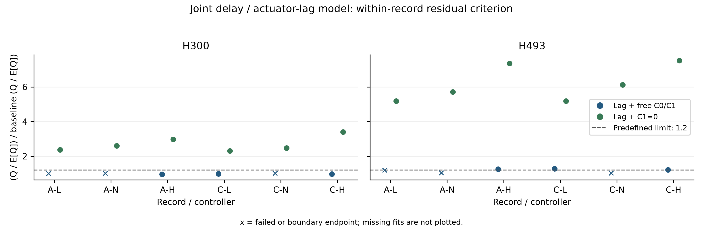
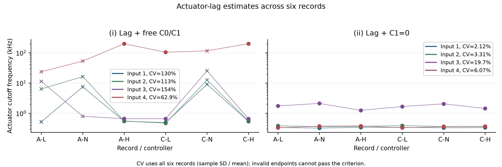

# 执行器一阶滞后检验报告

生成时间：2026-10-21T00:13:28.939849+09:00。本报告仅聚合已保存端点；不自动启动拟合，不删除失败样本。

## 1. 预设判据与结论

**未满足全部事先固定判据；主模型仍为自由 C0、C1，一阶滞后模型仅作讨论。**

已保存 12/12 个联合端点，其中有效 9/12 个。模型 ii 的数值残差比门槛通过 0/12 个窗口；截止频率 CV 数值门槛通过 4/4 路；六条模型 ii 端点是否均有效：是。数值门槛通过不替代端点有效性。

预先冻结：模型 ii 在六条记录的两个窗口中分别满足 Q/E[Q] 不超过原自由模型 a 的 1.2 倍；每路截止频率的六记录样本 SD/算术均值严格小于 20%（ddof=1）；六个端点均须通过原 score、内层矩收敛和未贴边门槛。三项同时满足才推荐模型 ii；不通过时仍保留原自由 C0、C1。

## 2. 模型及可比性

本次模型为 $G=E(\tau)\circ[\sum G_r+D_0+D_2]\operatorname{diag}\{(1+s/\omega_{a,m})^{-1}\}$。模型 i 保留自由 C0、C1，模型 ii 取自由 C0、C1=0。每条记录的 H300（220–420 Hz）和 H493（450–550 Hz）共享七个结构化时延与四个截止频率，其余模态、背景、瞬态参数分别估计；参数量分别为 285 和 205。原模型 a 是两个窗口独立估计时延的既有基线，不能把本次差异全部单独归因于新增滞后。

初始截止频率均为 2 kHz，技术搜索范围 20 Hz–200 kHz。公共时延使用既定 ±200 μs、10 μs间隔网格初始化。模态沿用精确 ZOH，右乘滞后严格采用任务给定的连续频响形式；不重新整体离散化，不额外减去半拍。既有输出瞬态不乘输入端滞后，未新增瞬态基函数。

采用同记录、原自由模型 a 已冻结的 0.5 Hz 非激励点噪声谱。Q/E[Q] 的线性化残差算子来自两个窗口的联合估计；每个窗口的 E[Q] 包含另一窗口通过共享参数传来的噪声。Q/E[Q] 下降可能同时涉及 Q 的改变与 E[Q] 的放大，因此下表同时列出两者及 E[Q]/n。

E[Q] 使用端点处冻结工具变量的 Gauss–Newton 线性化。当残差包含模型失配时，它不是原非线性估计器残差的精确分布或精确检验水平；本次沿用预定诊断指标，不将其改称精确 χ² 检验。

H300 原有约 263 Hz 宽背景分量保留，但不列为本次四个待报告物理模态。所有失败和边界端点仅供诊断，不能作为可靠物理参数解释。

## 3. 同记录残差比较

| 记录 | 模型 | 窗口 | 有效 | Q | E[Q] | n | E[Q]/n | Q/E[Q] | 原 a | 比值 | 数值≤1.2 |
| --- | --- | --- | --- | --- | --- | --- | --- | --- | --- | --- | --- |
| A_lowgain | a | H300 | 否 | 2.8822e+06 | 10814 | 9608 | 1.1256 | 266.51 | 268.04 | 0.99431 | 是 |
| A_lowgain | a | H493 | 否 | 3.6055e+05 | 5110.1 | 4808 | 1.0628 | 70.557 | 59.313 | 1.1896 | 是 |
| A_lowgain | c | H300 | 是 | 7.145e+06 | 11265 | 9608 | 1.1724 | 634.28 | 268.04 | 2.3664 | 否 |
| A_lowgain | c | H493 | 是 | 1.6249e+06 | 5290.6 | 4808 | 1.1004 | 307.14 | 59.313 | 5.1783 | 否 |
| A_nominal | a | H300 | 否 | 4.7419e+06 | 10176 | 9608 | 1.0591 | 466.01 | 463.24 | 1.006 | 是 |
| A_nominal | a | H493 | 否 | 6.4096e+05 | 4924.7 | 4808 | 1.0243 | 130.15 | 126.18 | 1.0315 | 是 |
| A_nominal | c | H300 | 是 | 1.2411e+07 | 10326 | 9608 | 1.0747 | 1202 | 463.24 | 2.5947 | 否 |
| A_nominal | c | H493 | 是 | 3.6113e+06 | 5013.4 | 4808 | 1.0427 | 720.33 | 126.18 | 5.7088 | 否 |
| A_highgain | a | H300 | 是 | 8.2851e+06 | 10315 | 9608 | 1.0736 | 803.18 | 837.01 | 0.95957 | 是 |
| A_highgain | a | H493 | 是 | 9.1347e+05 | 5006.8 | 4808 | 1.0413 | 182.45 | 145.13 | 1.2572 | 否 |
| A_highgain | c | H300 | 是 | 2.65e+07 | 10637 | 9608 | 1.1071 | 2491.2 | 837.01 | 2.9763 | 否 |
| A_highgain | c | H493 | 是 | 5.7045e+06 | 5342.6 | 4808 | 1.1112 | 1067.7 | 145.13 | 7.3572 | 否 |
| C_lowgain_pppp | a | H300 | 是 | 4.3414e+06 | 10404 | 9608 | 1.0828 | 417.3 | 425.53 | 0.98066 | 是 |
| C_lowgain_pppp | a | H493 | 是 | 3.7667e+05 | 5006.3 | 4808 | 1.0412 | 75.239 | 58.948 | 1.2764 | 否 |
| C_lowgain_pppp | c | H300 | 是 | 1.0589e+07 | 10776 | 9608 | 1.1216 | 982.62 | 425.53 | 2.3092 | 否 |
| C_lowgain_pppp | c | H493 | 是 | 1.5505e+06 | 5074.1 | 4808 | 1.0554 | 305.57 | 58.948 | 5.1837 | 否 |
| C_nominal_pppp | a | H300 | 否 | 4.4336e+06 | 10113 | 9608 | 1.0525 | 438.41 | 435.34 | 1.0071 | 是 |
| C_nominal_pppp | a | H493 | 否 | 4.1869e+05 | 4980.1 | 4808 | 1.0358 | 84.073 | 82.867 | 1.0145 | 是 |
| C_nominal_pppp | c | H300 | 是 | 1.1138e+07 | 10327 | 9608 | 1.0749 | 1078.5 | 435.34 | 2.4774 | 否 |
| C_nominal_pppp | c | H493 | 是 | 2.5869e+06 | 5094.4 | 4808 | 1.0596 | 507.79 | 82.867 | 6.1277 | 否 |
| C_highgain_pppp | a | H300 | 是 | 5.4243e+06 | 10363 | 9608 | 1.0786 | 523.43 | 542.17 | 0.96544 | 是 |
| C_highgain_pppp | a | H493 | 是 | 6.644e+05 | 4955.9 | 4808 | 1.0308 | 134.06 | 110.59 | 1.2123 | 否 |
| C_highgain_pppp | c | H300 | 是 | 1.9597e+07 | 10631 | 9608 | 1.1065 | 1843.4 | 542.17 | 3.4 | 否 |
| C_highgain_pppp | c | H493 | 是 | 4.2466e+06 | 5103.5 | 4808 | 1.0615 | 832.11 | 110.59 | 7.5244 | 否 |

相对基线的门槛通过不等于 Q/E[Q] 已接近 1，也不能证明模型在噪声水平上已充分。



## 4. 截止频率、记录间离散与时延

| 记录 | 模型 | 有效 | fa1/Hz | fa2/Hz | fa3/Hz | fa4/Hz |
| --- | --- | --- | --- | --- | --- | --- |
| A_lowgain | a | 否 | 521.1785 | 6363.937 | 11281.85 | 23535.94 |
| A_lowgain | c | 是 | 339.1609 | 384.7304 | 1748.755 | 330.6028 |
| A_nominal | a | 否 | 7455.879 | 16230.85 | 791.7992 | 53058.07 |
| A_nominal | c | 是 | 323.4408 | 360.6921 | 2112.585 | 373.794 |
| A_highgain | a | 是 | 542.2716 | 552.5584 | 659.6513 | 199578.2 |
| A_highgain | c | 是 | 342.0971 | 366.4446 | 1247.372 | 380.8754 |
| C_lowgain_pppp | a | 是 | 492.457 | 470.479 | 656.3699 | 104137.7 |
| C_lowgain_pppp | c | 是 | 340.6255 | 389.5849 | 1670.821 | 330.983 |
| C_nominal_pppp | a | 否 | 9044.129 | 12527.53 | 25301.9 | 115910.2 |
| C_nominal_pppp | c | 是 | 330.7748 | 363.6683 | 2044.973 | 360.2301 |
| C_highgain_pppp | a | 是 | 538.3283 | 550.6183 | 651.5009 | 199597.4 |
| C_highgain_pppp | c | 是 | 336.5206 | 364.5228 | 1434.204 | 367.9498 |

| 模型 | 输入 | 六条均有效 | 均值/Hz | 样本SD/Hz | CV/% | 最小/Hz | 最大/Hz | 极差/Hz |
| --- | --- | --- | --- | --- | --- | --- | --- | --- |
| a | 1 | 否 | 3099 | 4021.4 | 129.76 | 492.46 | 9044.1 | 8551.7 |
| a | 2 | 否 | 6116 | 6888.8 | 112.64 | 470.48 | 16231 | 15760 |
| a | 3 | 否 | 6557.2 | 10113 | 154.23 | 651.5 | 25302 | 24650 |
| a | 4 | 否 | 1.1597e+05 | 72974 | 62.925 | 23536 | 1.996e+05 | 1.7606e+05 |
| c | 1 | 是 | 335.44 | 7.0988 | 2.1163 | 323.44 | 342.1 | 18.656 |
| c | 2 | 是 | 371.61 | 12.284 | 3.3055 | 360.69 | 389.58 | 28.893 |
| c | 3 | 是 | 1709.8 | 336.87 | 19.702 | 1247.4 | 2112.6 | 865.21 |
| c | 4 | 是 | 357.41 | 21.703 | 6.0724 | 330.6 | 380.88 | 50.273 |

CV 只在六个数值齐备时计算，失败端点仍保留在诊断统计中；任何一个端点无效均使其不能作为预设跨记录离散判据的通过证据。不改用成功子集，不用极差代替预设 CV。

截止频率还可能与自由 C1 和时延混淆：在无背景、无瞬态的连续模态理想化中，若分子写为 C0+(s/ωr)C1，取 C1=(ωr/ωa)C0 可精确消去相同通道的一阶滞后；当前 ZOH 模态与背景下该式不再是整体精确恒等式，但仍提示近似混淆方向。另外 log L≈−s/ωa，使低阶相位信息中的时延与 1/ωa 相关。因此记录间 CV 小不自动证明估计到了硬件真实截止频率。



下表均为 μs，输出端与输入端相对时延各自和为零。两个窗口已共享同一组参数，因此本次不会再出现两个窗口独立时延估计的差值；共享本身并不是跨窗口相容性得到验证。

| 记录 | 模型 | 公共 | 输出1 | 输出2 | 输出3 | 输出4 | 输入1 | 输入2 | 输入3 | 输入4 |
| --- | --- | --- | --- | --- | --- | --- | --- | --- | --- | --- |
| A_lowgain | a | 235.33 | 10.384 | -7.7237 | -4.0038 | 1.3439 | -175.83 | 52.848 | 44.632 | 78.346 |
| A_lowgain | c | -23.106 | 3.8964 | 1.5054 | -0.12764 | -5.2741 | -49.803 | -46.795 | 176.26 | -79.661 |
| A_nominal | a | 257.14 | -8.3364 | -1.1614 | 3.7212 | 5.7767 | 45.76 | 37.026 | -146.28 | 63.49 |
| A_nominal | c | -18.66 | 3.2245 | 1.7883 | -0.20268 | -4.8102 | -59.953 | -63.949 | 186.42 | -62.516 |
| A_highgain | a | 131.99 | -3.6471 | -1.4812 | -0.43011 | 5.5584 | -62.083 | -71.678 | -51.082 | 184.84 |
| A_highgain | c | -26.747 | 3.5803 | 1.9224 | -0.76018 | -4.7425 | -40.329 | -50.728 | 145.07 | -54.01 |
| C_lowgain_pppp | a | 121.51 | 3.8302 | -2.9744 | -1.9288 | 1.073 | -69.312 | -87.062 | -40.53 | 196.9 |
| C_lowgain_pppp | c | -22.764 | 4.04 | 1.3433 | 0.041496 | -5.4249 | -48.873 | -44.196 | 172.78 | -79.711 |
| C_nominal_pppp | a | 301.84 | -6.4913 | 0.73139 | 1.8795 | 3.8804 | 4.5551 | -11.536 | -13.116 | 20.097 |
| C_nominal_pppp | c | -19.167 | 3.2601 | 1.8955 | -0.28224 | -4.8734 | -54.04 | -61.694 | 184.07 | -68.335 |
| C_highgain_pppp | a | 131.09 | -4.022 | -1.0662 | -0.096359 | 5.1845 | -62.299 | -71.862 | -51.927 | 186.09 |
| C_highgain_pppp | c | -26.11 | 3.5567 | 1.9055 | -0.75799 | -4.7042 | -45.802 | -53.339 | 159.98 | -60.838 |

## 5. 四个模态的模型结构敏感性

f 的绝对差单位为 Hz；ζ 的绝对差为阻尼百分数之差，单位为百分点。相对差统一采用 100×[exp(log(新值)−log(基线值))−1]，以原自由模型 a 为基线。以下不把模型间范围当作具有概率覆盖率的标准不确定度；它描述在这三种结构选择之间的敏感性。

| 记录 | 模态/Hz | 模型 | 有效 | f/Hz | Δf/Hz | Δf/% | ζ/% | Δζ/百分点 | Δζ/% |
| --- | --- | --- | --- | --- | --- | --- | --- | --- | --- |
| A_lowgain | 282 | baseline | 是 | 282.01902 | 0 | 0 | 1.94997 | 0 | 0 |
| A_lowgain | 282 | a | 否 | 282.00804 | -0.010979 | -0.0038931 | 1.952351 | 0.0023817 | 0.12214 |
| A_lowgain | 282 | c | 是 | 281.25411 | -0.76491 | -0.27123 | 1.832378 | -0.11759 | -6.0304 |
| A_lowgain | 333 | baseline | 是 | 333.2905 | 0 | 0 | 0.6453336 | 0 | 0 |
| A_lowgain | 333 | a | 否 | 333.28694 | -0.0035632 | -0.0010691 | 0.6474817 | 0.0021481 | 0.33286 |
| A_lowgain | 333 | c | 是 | 333.83539 | 0.54488 | 0.16349 | 0.6398115 | -0.0055221 | -0.8557 |
| A_lowgain | 359 | baseline | 是 | 358.64708 | 0 | 0 | 0.257413 | 0 | 0 |
| A_lowgain | 359 | a | 否 | 358.64723 | 0.0001448 | 4.0375e-05 | 0.2574571 | 4.4082e-05 | 0.017125 |
| A_lowgain | 359 | c | 是 | 358.65177 | 0.0046879 | 0.0013071 | 0.2577574 | 0.00034444 | 0.13381 |
| A_lowgain | 493 | baseline | 是 | 493.50789 | 0 | 0 | 0.3606934 | 0 | 0 |
| A_lowgain | 493 | a | 否 | 493.50827 | 0.00038557 | 7.8128e-05 | 0.3606285 | -6.494e-05 | -0.018004 |
| A_lowgain | 493 | c | 是 | 493.52431 | 0.016422 | 0.0033277 | 0.3587406 | -0.0019529 | -0.54142 |
| A_nominal | 282 | baseline | 是 | 282.13038 | 0 | 0 | 1.916784 | 0 | 0 |
| A_nominal | 282 | a | 否 | 282.12571 | -0.0046717 | -0.0016559 | 1.915127 | -0.0016577 | -0.086483 |
| A_nominal | 282 | c | 是 | 281.44654 | -0.68383 | -0.24238 | 1.829791 | -0.086994 | -4.5385 |
| A_nominal | 333 | baseline | 是 | 333.38131 | 0 | 0 | 0.6675644 | 0 | 0 |
| A_nominal | 333 | a | 否 | 333.39149 | 0.010179 | 0.0030534 | 0.6712886 | 0.0037241 | 0.55787 |
| A_nominal | 333 | c | 是 | 333.90825 | 0.52694 | 0.15806 | 0.6115606 | -0.056004 | -8.3893 |
| A_nominal | 359 | baseline | 是 | 358.68432 | 0 | 0 | 0.2513934 | 0 | 0 |
| A_nominal | 359 | a | 否 | 358.68465 | 0.00032933 | 9.1815e-05 | 0.251443 | 4.9629e-05 | 0.019741 |
| A_nominal | 359 | c | 是 | 358.68885 | 0.0045318 | 0.0012634 | 0.2537273 | 0.0023339 | 0.92839 |
| A_nominal | 493 | baseline | 是 | 493.61413 | 0 | 0 | 0.3632723 | 0 | 0 |
| A_nominal | 493 | a | 否 | 493.61401 | -0.00012176 | -2.4667e-05 | 0.3633151 | 4.2833e-05 | 0.011791 |
| A_nominal | 493 | c | 是 | 493.62493 | 0.010796 | 0.0021871 | 0.3616703 | -0.001602 | -0.44099 |
| A_highgain | 282 | baseline | 是 | 282.02092 | 0 | 0 | 1.947979 | 0 | 0 |
| A_highgain | 282 | a | 是 | 282.0057 | -0.015215 | -0.0053948 | 1.952477 | 0.0044985 | 0.23093 |
| A_highgain | 282 | c | 是 | 281.30041 | -0.72051 | -0.25548 | 1.839287 | -0.10869 | -5.5797 |
| A_highgain | 333 | baseline | 是 | 333.64342 | 0 | 0 | 0.6045704 | 0 | 0 |
| A_highgain | 333 | a | 是 | 333.65432 | 0.010904 | 0.0032683 | 0.6040193 | -0.00055116 | -0.091166 |
| A_highgain | 333 | c | 是 | 334.06381 | 0.42039 | 0.126 | 0.5627773 | -0.041793 | -6.9129 |
| A_highgain | 359 | baseline | 是 | 358.67986 | 0 | 0 | 0.2475362 | 0 | 0 |
| A_highgain | 359 | a | 是 | 358.68052 | 0.00065239 | 0.00018189 | 0.2474034 | -0.0001328 | -0.053649 |
| A_highgain | 359 | c | 是 | 358.68353 | 0.0036662 | 0.0010221 | 0.2489871 | 0.0014509 | 0.58614 |
| A_highgain | 493 | baseline | 是 | 493.52764 | 0 | 0 | 0.3601727 | 0 | 0 |
| A_highgain | 493 | a | 是 | 493.52778 | 0.00014224 | 2.8822e-05 | 0.3602518 | 7.9167e-05 | 0.02198 |
| A_highgain | 493 | c | 是 | 493.53308 | 0.0054371 | 0.0011017 | 0.3577618 | -0.0024109 | -0.66937 |
| C_lowgain_pppp | 282 | baseline | 是 | 282.03324 | 0 | 0 | 1.955122 | 0 | 0 |
| C_lowgain_pppp | 282 | a | 是 | 282.01693 | -0.01632 | -0.0057864 | 1.96216 | 0.0070383 | 0.35999 |
| C_lowgain_pppp | 282 | c | 是 | 281.25403 | -0.77921 | -0.27628 | 1.837217 | -0.1179 | -6.0305 |
| C_lowgain_pppp | 333 | baseline | 是 | 333.33028 | 0 | 0 | 0.6334116 | 0 | 0 |
| C_lowgain_pppp | 333 | a | 是 | 333.33853 | 0.0082585 | 0.0024776 | 0.6320868 | -0.0013247 | -0.20914 |
| C_lowgain_pppp | 333 | c | 是 | 333.86319 | 0.53291 | 0.15987 | 0.624074 | -0.0093376 | -1.4742 |
| C_lowgain_pppp | 359 | baseline | 是 | 358.65595 | 0 | 0 | 0.2550031 | 0 | 0 |
| C_lowgain_pppp | 359 | a | 是 | 358.65635 | 0.00040286 | 0.00011233 | 0.2549246 | -7.8511e-05 | -0.030788 |
| C_lowgain_pppp | 359 | c | 是 | 358.65926 | 0.0033116 | 0.00092333 | 0.2550442 | 4.1069e-05 | 0.016105 |
| C_lowgain_pppp | 493 | baseline | 是 | 493.51517 | 0 | 0 | 0.3596089 | 0 | 0 |
| C_lowgain_pppp | 493 | a | 是 | 493.51564 | 0.00046829 | 9.4889e-05 | 0.3595092 | -9.9646e-05 | -0.027709 |
| C_lowgain_pppp | 493 | c | 是 | 493.53184 | 0.016667 | 0.0033772 | 0.3577132 | -0.0018956 | -0.52714 |
| C_nominal_pppp | 282 | baseline | 是 | 282.01341 | 0 | 0 | 1.93402 | 0 | 0 |
| C_nominal_pppp | 282 | a | 否 | 282.00979 | -0.0036148 | -0.0012818 | 1.932278 | -0.0017426 | -0.090105 |
| C_nominal_pppp | 282 | c | 是 | 281.32378 | -0.68963 | -0.24454 | 1.839813 | -0.094207 | -4.8711 |
| C_nominal_pppp | 333 | baseline | 是 | 333.23744 | 0 | 0 | 0.6667235 | 0 | 0 |
| C_nominal_pppp | 333 | a | 否 | 333.23808 | 0.00064683 | 0.00019411 | 0.672494 | 0.0057704 | 0.86549 |
| C_nominal_pppp | 333 | c | 是 | 333.75887 | 0.52143 | 0.15647 | 0.6064965 | -0.060227 | -9.0333 |
| C_nominal_pppp | 359 | baseline | 是 | 358.62242 | 0 | 0 | 0.2507668 | 0 | 0 |
| C_nominal_pppp | 359 | a | 否 | 358.62246 | 4.3086e-05 | 1.2014e-05 | 0.250851 | 8.418e-05 | 0.033569 |
| C_nominal_pppp | 359 | c | 是 | 358.62813 | 0.0057111 | 0.0015925 | 0.2534309 | 0.0026641 | 1.0624 |
| C_nominal_pppp | 493 | baseline | 是 | 493.52452 | 0 | 0 | 0.3617099 | 0 | 0 |
| C_nominal_pppp | 493 | a | 否 | 493.52444 | -8.1469e-05 | -1.6508e-05 | 0.3617334 | 2.3519e-05 | 0.0065021 |
| C_nominal_pppp | 493 | c | 是 | 493.53576 | 0.011247 | 0.0022789 | 0.3599189 | -0.001791 | -0.49516 |
| C_highgain_pppp | 282 | baseline | 是 | 282.03433 | 0 | 0 | 1.951656 | 0 | 0 |
| C_highgain_pppp | 282 | a | 是 | 282.0191 | -0.015234 | -0.0054014 | 1.956312 | 0.0046552 | 0.23853 |
| C_highgain_pppp | 282 | c | 是 | 281.30751 | -0.72682 | -0.25771 | 1.839928 | -0.11173 | -5.7248 |
| C_highgain_pppp | 333 | baseline | 是 | 333.67558 | 0 | 0 | 0.6005978 | 0 | 0 |
| C_highgain_pppp | 333 | a | 是 | 333.68661 | 0.011029 | 0.0033054 | 0.6000997 | -0.00049815 | -0.082942 |
| C_highgain_pppp | 333 | c | 是 | 334.09425 | 0.41868 | 0.12547 | 0.5592851 | -0.041313 | -6.8786 |
| C_highgain_pppp | 359 | baseline | 是 | 358.68979 | 0 | 0 | 0.2465014 | 0 | 0 |
| C_highgain_pppp | 359 | a | 是 | 358.69043 | 0.00064162 | 0.00017888 | 0.2463736 | -0.00012779 | -0.051842 |
| C_highgain_pppp | 359 | c | 是 | 358.69359 | 0.0037935 | 0.0010576 | 0.2480367 | 0.0015353 | 0.62284 |
| C_highgain_pppp | 493 | baseline | 是 | 493.51278 | 0 | 0 | 0.3574891 | 0 | 0 |
| C_highgain_pppp | 493 | a | 是 | 493.51325 | 0.00046436 | 9.4092e-05 | 0.3576021 | 0.00011293 | 0.031589 |
| C_highgain_pppp | 493 | c | 是 | 493.52049 | 0.0077051 | 0.0015613 | 0.3551416 | -0.0023476 | -0.65668 |

| 记录 | 模态/Hz | 三端点均有效 | f模型范围/Hz | ζ模型范围/百分点 |
| --- | --- | --- | --- | --- |
| A_lowgain | 282 | 否 | 0.76491 | 0.11997 |
| A_lowgain | 333 | 否 | 0.54845 | 0.0076702 |
| A_lowgain | 359 | 否 | 0.0046879 | 0.00034444 |
| A_lowgain | 493 | 否 | 0.016422 | 0.0019529 |
| A_nominal | 282 | 否 | 0.68383 | 0.086994 |
| A_nominal | 333 | 否 | 0.52694 | 0.059728 |
| A_nominal | 359 | 否 | 0.0045318 | 0.0023339 |
| A_nominal | 493 | 否 | 0.010917 | 0.0016448 |
| A_highgain | 282 | 是 | 0.72051 | 0.11319 |
| A_highgain | 333 | 是 | 0.42039 | 0.041793 |
| A_highgain | 359 | 是 | 0.0036662 | 0.0015837 |
| A_highgain | 493 | 是 | 0.0054371 | 0.0024901 |
| C_lowgain_pppp | 282 | 是 | 0.77921 | 0.12494 |
| C_lowgain_pppp | 333 | 是 | 0.53291 | 0.0093376 |
| C_lowgain_pppp | 359 | 是 | 0.0033116 | 0.00011958 |
| C_lowgain_pppp | 493 | 是 | 0.016667 | 0.0018956 |
| C_nominal_pppp | 282 | 否 | 0.68963 | 0.094207 |
| C_nominal_pppp | 333 | 否 | 0.52143 | 0.065997 |
| C_nominal_pppp | 359 | 否 | 0.0057111 | 0.0026641 |
| C_nominal_pppp | 493 | 否 | 0.011328 | 0.0018146 |
| C_highgain_pppp | 282 | 是 | 0.72682 | 0.11638 |
| C_highgain_pppp | 333 | 是 | 0.41868 | 0.041313 |
| C_highgain_pppp | 359 | 是 | 0.0037935 | 0.0016631 |
| C_highgain_pppp | 493 | 是 | 0.0077051 | 0.0024605 |

## 6. 求解状态、失败与边界

| 记录 | 模型 | 状态 | score | 迭代 | 内层失败调用 | 贴边 | 截止贴边 | 参数数 | 秒 |
| --- | --- | --- | --- | --- | --- | --- | --- | --- | --- |
| A_lowgain | a | 无效：profile_hybrid_failed | 7.609e-05 | 55 | 0 | False | False | 285 | 125.5 |
| A_lowgain | c | 有效：profile_hybrid_root | 8.0775e-13 | 55 | 0 | False | False | 205 | 54.679 |
| A_nominal | a | 无效：profile_hybrid_failed | 0.00010968 | 34 | 0 | False | False | 285 | 117.46 |
| A_nominal | c | 有效：profile_hybrid_root | 5.3759e-13 | 55 | 0 | False | False | 205 | 68.463 |
| A_highgain | a | 有效：profile_hybrid_failed | 1.4057e-07 | 35 | 0 | False | False | 285 | 63.422 |
| A_highgain | c | 有效：profile_hybrid_root | 1.5905e-12 | 55 | 0 | False | False | 205 | 26.161 |
| C_lowgain_pppp | a | 有效：profile_hybrid_failed | 2.447e-07 | 55 | 0 | False | False | 285 | 122.65 |
| C_lowgain_pppp | c | 有效：profile_hybrid_root | 6.6683e-13 | 55 | 0 | False | False | 205 | 63.692 |
| C_nominal_pppp | a | 无效：profile_hybrid_failed | 9.1388e-05 | 34 | 0 | False | False | 285 | 112.03 |
| C_nominal_pppp | c | 有效：profile_hybrid_root | 5.121e-13 | 55 | 0 | False | False | 205 | 76.767 |
| C_highgain_pppp | a | 有效：profile_hybrid_failed | 2.3068e-07 | 35 | 0 | False | False | 285 | 27.579 |
| C_highgain_pppp | c | 有效：profile_hybrid_root | 8.6037e-13 | 55 | 0 | False | False | 205 | 32.507 |

“内层失败调用”统计优化试探期间未收敛的内层调用，不等于最终端点失败；最终有效性使用原求解器终止状态、严格 score 与边界检查。全部初始化网格、求解轨迹和异常保存在 raw/ 与 logs/。

下表的条件数来自审计中缩放后的联合矩阵；`rank` 的相对阈值为 1e−12。截止频率距技术上界小于 1% 是新增诊断标记，不追溯改变原有效性门槛或预设模型选择规则。

| 记录 | 模型 | 缩放条件数 | rank/参数数 | 距200 kHz上界<1%的输入 |
| --- | --- | --- | --- | --- |
| A_lowgain | a | 1.6542e+10 | 285/285 | 无 |
| A_lowgain | c | 1.3338e+05 | 205/205 | 无 |
| A_nominal | a | 8.344e+10 | 285/285 | 无 |
| A_nominal | c | 2.409e+05 | 205/205 | 无 |
| A_highgain | a | 1.3029e+12 | 284/285 | 4 |
| A_highgain | c | 40145 | 205/205 | 无 |
| C_lowgain_pppp | a | 3.6549e+11 | 285/285 | 无 |
| C_lowgain_pppp | c | 1.164e+05 | 205/205 | 无 |
| C_nominal_pppp | a | 3.6606e+11 | 285/285 | 无 |
| C_nominal_pppp | c | 2.1686e+05 | 205/205 | 无 |
| C_highgain_pppp | a | 1.2283e+12 | 284/285 | 4 |
| C_highgain_pppp | c | 59464 | 205/205 | 无 |

自由 C1 的滞后模型 i 有 3 个失败端点：A_lowgain、A_nominal、C_nominal_pppp。

另有以下求解门槛已通过的端点接近技术上界：A_highgain 的输入 4 为 199.5782 kHz；C_highgain_pppp 的输入 4 为 199.5974 kHz。结合大条件数与近秩缺失，这些数值不能作为硬件截止频率解释。保持其原成功状态，另行标明弱辨识问题。

失败或未完成端点：

| 记录 | 模型 | 原因 |
| --- | --- | --- |
| A_lowgain | a | 无效：profile_hybrid_failed |
| A_nominal | a | 无效：profile_hybrid_failed |
| C_nominal_pppp | a | 无效：profile_hybrid_failed |

## 7. 数值核查与文件审计

另见 `analysis/独立实现核查.md`。独立只读审查未发现输入滞后方向、共享参数映射、内层矩方程或联合残差期望的实现错误。模型 ii 六个端点均满秩且严格收敛；其残差门槛失败不能归因于明显的求根未收敛。此项核查不保证全局根唯一。

核查记录：`analysis/audit.json`。

```json
{
  "original_files": 6221,
  "changed": [],
  "missing": [],
  "original_unchanged": true,
  "required": 12,
  "completed": 12,
  "successful": 9,
  "all_results_present": true,
  "verification_passed": true
}
```

核查记录：`analysis/verification.json`。

| 模型 | 通过 | 最大导数相对差 | 零滞后极限差 | 矩阵差 | 线性score |
| --- | --- | --- | --- | --- | --- |
| a | True | 1.031e-07 | 4.9652e-14 | 6.5179e-16 | 1.542e-14 |
| c | True | 1.5865e-07 | 4.965e-14 | 5.3689e-16 | 7.6356e-14 |

核查记录：`analysis/verification_step_1e-5.json`。

| 模型 | 通过 | 最大导数相对差 | 零滞后极限差 | 矩阵差 | 线性score |
| --- | --- | --- | --- | --- | --- |
| a | False | 1.0354e-05 | 4.9652e-14 | 6.5179e-16 | 1.542e-14 |
| c | False | 1.5864e-05 | 4.965e-14 | 5.3689e-16 | 7.6356e-14 |

初始有限差分步长 1e−5 的核查文件也保留在上表，不能忽略其未通过状态。随后步长缩小为 1e−6，导数误差约缩小 100 倍，符合中心差分截断误差的二阶缩放。最终验证没有放宽原阈值；该对照用于区分有限差分截断误差与解析导数错误。

联合残差期望的独立核查采用 A_nominal、模型 c，生成 200 组复高斯噪声。分别比较解析 E[Q]、独立低秩迹公式，以及固定线性化残差算子下的抽样均值。这检验期望计算的实现，不把模型失配变成高斯噪声。

| 窗口 | 解析E[Q] | 独立低秩迹 | 迹相对差 | 抽样均值 | 均值MCSE | 差/MCSE |
| --- | --- | --- | --- | --- | --- | --- |
| H300 | 10325.7228 | 10325.7228 | 7.5749e-15 | 10303.371 | 17.961 | -1.2444 |
| H493 | 5013.42644 | 5013.42644 | 1.2336e-14 | 5023.0962 | 11.094 | 0.87161 |

## 8. 范围与限制

- 本次只做既有六条记录、两个既有高频窗口的 M3 联合拟合，没有新增数据、改窗口或增减模态。
- 不新增 jackknife，截止频率的记录间 CV 不是单条记录内的参数标准误，不能凭其大小独立判断滞后已与留数、时延充分分离。
- 联合残差检验使用既定冻结噪声谱；不通过时不换权重、模型背景或判据来调整结论。
- 20 Hz–200 kHz 为明确记录的技术搜索范围，贴边结果不作可辨识的物理截止频率。
- 当前保留原逐模态输出瞬态，没有新增执行器滞后极点对应的瞬态项；既有 ZOH 模态右乘连续一阶频响也不等价于连续总串联系统整体进行 ZOH 离散化。
- 两个滞后模型同时约束跨窗口时延与滞后相同，原 a 基线各窗口时延独立。模型间范围包含这项结构约束的影响。
- 保存下来的失败端点可显示数值，但不作为物理模型推荐依据；完整 CSV 记录有效性标记。

输出索引：`analysis/lag_summary.json` 是机器可读判定；`lag_qe.csv`、`lag_cutoffs.csv`、`lag_cutoff_stats.csv`、`lag_delays.csv`、`lag_modal_differences.csv`、`lag_structural_ranges.csv` 和 `lag_endpoints.csv` 为完整明细。图同时保存 PNG（300 dpi）和 PDF。
