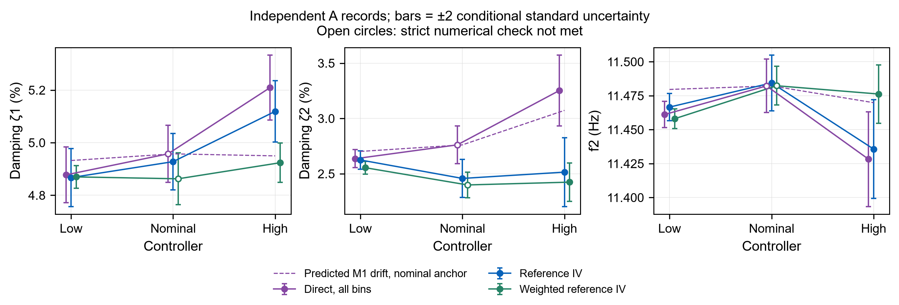
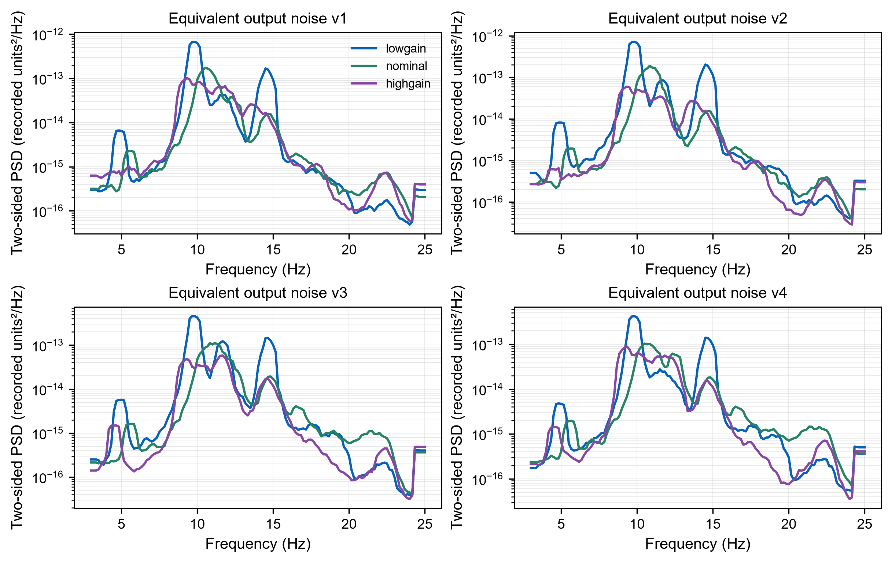
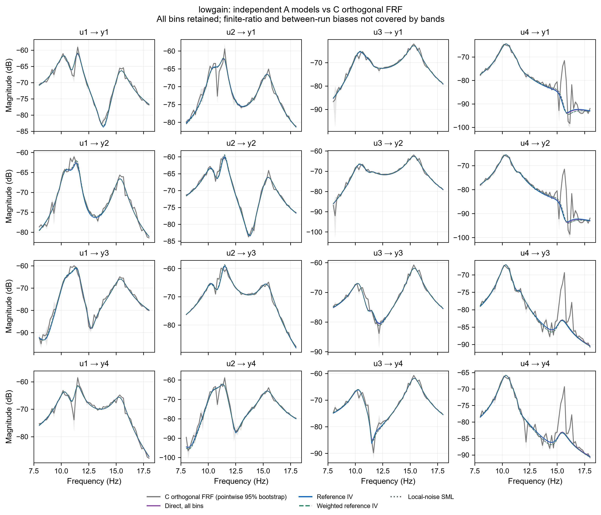

# 新实测数据分析报告：A–E五组闭环频域辨识

日期：2026-10-20。按提供的采集方案、任务清单和既有实测代码执行。输出限于本目录，原始27个MAT、旧算法与理论文档未修改。

## 0. 结论与预设判据

**本批数据提供了有价值但不完整的支持：第二阶阻尼的直接法漂移清楚，参考IV削弱了这一变化；“三个模态全部在2倍不确定度内不变”没有通过。** 不能把一个有利参数扩展为所有模态一致，不能把数值收敛扩展为模型正确。

A组三个控制器下的第二阶阻尼为：

| 控制器 | M1全部频点直接法/% | M2谱线直接法/% | M3参考IV/% | M3w加权参考IV/% | M5n邻点SML/% |
| --- | --- | --- | --- | --- | --- |
| lowgain | 2.6364 | 2.6335 | 2.6249 | 2.5548 | 2.5521 |
| nominal | 2.7617 | 2.4862 | 2.4582 | 2.3993 | 2.3734 |
| highgain | 3.2531 | 2.5942 | 2.5151 | 2.4245 | 2.3991 |

低增益→高增益时，M1第二阶阻尼变化+0.6167个百分点；M3变化−0.1098个百分点。用各控制器B噪声谱作局部偏差预测，预测M1偏差的变化为+0.3711个百分点，实测/预测为1.66。这支持反馈偏差机制的方向和量级，但不是全部参数的精确预测，也不能忽略M3自身的运行间变化。

| 预设项目 | 结果 | 解释 |
| --- | --- | --- |
| M3三个模态f、ζ跨控制器均<2合成u | **未通过：8/18对满足** | 第二阶阻尼3/3对满足，但其他参数未全部满足 |
| M3w同一要求 | **未通过：9/18对满足** | 还存在严格score未过的端点，冻结随机权u也不包含权估计影响 |
| M1的ζ1或ζ2跨控制器漂移>2u | 满足局部模型近似下的数值条件 | M1的u使用直接矩的Gaussian局部近似，不冒称定理2 |
| 实测漂移与理论同向、同量级 | 第二阶阻尼部分支持；整体未通过 | 全部参数的方向和比值见表；原方案未给量级阈值，未事后新增 |
| C组不同控制器FRF相容 | **未通过条件bootstrap检查** | nominal/highgain的比值反演仍不稳定，参照不能作真值 |
| D/重复实验不确定度覆盖 | **不能认定通过** | D实际为幅值扫描；同幅A+C样本也有超出模型u的离散 |

完成94组主估计，4组按原迭代规则失败；全部端点与异常保留。共20幅图，每幅均有300dpi PNG和PDF；表格完整数值在analysis/*.csv。

## 1. 数据整理、信号边界及质检

MAT内部压缩块存在已知zlib校验问题。按raw-deflate只读解压，检查流已结束、内部MAT可解析、16个变量完整；没有重写源MAT。按每路时间列对齐到5kHz公共采样格。时间打印精度误差约0.0005个采样，容许0.01个采样后取整数格，不对信号插值。

B组记录的disturb_input并不是实际注入：B中U=C到数值精度，实际参考为0。由B回归所得T是秩3控制输出子空间上的最小范数表示；由于C自身秩3，不能称4×4 T被唯一物理辨识出来。T在全部记录上用于核验U−TC=D的注入边界，且K=−TK_c在实际控制子空间内有效。

注入区间以逐点‖U−TC−D‖<10⁻⁵max(‖D‖,10⁻⁴)且有效注入幅值非零检测。先丢1周期；若首个保留周期间去均值Y差大于后续差的中位数2倍，则继续丢首周期，至少留下3周期。这个规则在辨识前固定，完全不使用拟合结果。C_lowgain_ppmm共丢3周期，E的−0.5mm共丢2周期，其余激励记录丢1周期。全部原始相邻周期差与截取索引保存。

| 记录 | 注入区间（B为记录区间）/s | 丢弃周期 | 保留P | 用途/备注 |
| --- | --- | --- | --- | --- |
| A_highgain | 注入 10.660–67.470 | 1 | 8 | 可用；不代表模型成立 |
| A_lowgain | 注入 117.369–166.718 | 1 | 7 | 可用；不代表模型成立 |
| A_nominal | 注入 12.505–64.118 | 1 | 7 | 可用；不代表模型成立 |
| B_highgain | 记录 7.770–60.896 | — | 8 | 纯噪声，记录D未实际注入 |
| B_lowgain | 记录 30.653–71.254 | — | 6 | 纯噪声，记录D未实际注入 |
| B_nominal | 记录 9.932–63.729 | — | 8 | 纯噪声，记录D未实际注入 |
| C_highgain_pmmp | 注入 122.640–168.832 | 1 | 6 | 可用；不代表模型成立 |
| C_highgain_pmpm | 注入 125.160–169.977 | 1 | 6 | 可用；不代表模型成立 |
| C_highgain_ppmm | 注入 11.307–52.665 | 1 | 5 | 可用；不代表模型成立 |
| C_highgain_pppp | 注入 6.215–51.336 | 1 | 6 | 可用；不代表模型成立 |
| C_lowgain_pmmp | 注入 3.600–59.291 | 1 | 8 | 可用；不代表模型成立 |
| C_lowgain_pmpm | 注入 5.946–54.108 | 1 | 7 | 可用；不代表模型成立 |
| C_lowgain_ppmm | 注入 3.890–56.418 | 3 | 5 | 可用；不代表模型成立 |
| C_lowgain_pppp | 注入 8.368–60.057 | 1 | 7 | 可用；不代表模型成立 |
| C_nominal_pmmp | 注入 38.954–87.776 | 1 | 7 | 可用；不代表模型成立 |
| C_nominal_pmpm | 注入 7.254–62.032 | 1 | 8 | 可用；不代表模型成立 |
| C_nominal_ppmm | 注入 8.531–62.588 | 1 | 8 | 可用；不代表模型成立 |
| C_nominal_pppp | 注入 7.827–54.242 | 1 | 6 | 可用；不代表模型成立 |
| D_nominal_0p6 | 注入 17.363–64.387 | 1 | 6 | 可用；不代表模型成立 |
| D_nominal_0p8 | 注入 4.634–63.960 | 1 | 8 | 可用；不代表模型成立 |
| D_nominal_1p0 | 注入 7.881–51.514 | 1 | 6 | 可用；不代表模型成立 |
| D_nominal_1p2 | 注入 5.046–54.569 | 1 | 7 | 可用；不代表模型成立 |
| D_nominal_1p5 | 同A_nominal | — | — | 重复：A_nominal |
| E_nominal_m0p5 | 注入 14.632–62.199 | 2 | 5 | 可用；不代表模型成立 |
| E_nominal_m1p0 | 注入 157.960–202.547 | 1 | 6 | 可用；不代表模型成立 |
| E_nominal_0p5 | 注入 103.045–150.762 | 1 | 6 | 可用；不代表模型成立 |
| E_nominal_1p0 | 注入 8.064–62.242 | 1 | 8 | 可用；不代表模型成立 |

27个文件实际为26个独立记录，其中23个有激励、3个纯噪声。D_nominal_1p5与A_nominal字节完全相同，没有重复计数。没有看到电机极值长时间重复造成的明显削顶特征，但未提供硬件量程，不能完成绝对饱和/限位认证。传感器量化与物理记录单位保持原样。

## 2. 控制器、噪声与实际激励

用B记录前半拟合完整ARX(8,8)的C←Y，后半与A/C/D/E独立数据验证。E的非零位置会增加常量设定值项：用训练半段恢复常量，独立后半验证；该常量不改变3–25Hz的传递函数。这消除了“位置非零就误报控制器改变”的问题，没有用近似低阶控制器替代。

| 控制器 | B后半ARX相对残差 | 独立A/B恢复K相对差 | 归一化C参考矩阵最大条件数 |
| --- | --- | --- | --- |
| lowgain | 2.17e-11 | 1.45e-07 | 1.000000 |
| nominal | 2.82e-11 | 3.58e-07 | 1.000000 |
| highgain | 5.92e-12 | 2.39e-08 | 1.000000 |

控制器恢复精度足以排除明显控制器符号/边界错误。所谓“精确”指记录算术精度范围内复现，不是代数系数零误差。控制器图用S_u=(I+KG)⁻¹、F=S_uK；1–500Hz的G来自C组非参数矩阵，未外推三支承模态模型。宽带回路/灵敏度曲线受该FRF不稳定影响，仅作诊断。

B噪声按每周期DFT形成V=Y−G_M3 U。以5邻频点平均、0.1对角收缩得到Φ_v，定义为N⁻¹/²归一化DFT的协方差；除以fs才是双边每Hz PSD。周期bootstrap区间只含给定G下的随机重复性。另保留用C非参数G提取的噪声作敏感性对照。

| 控制器 | B完整周期数 | 带内噪声能量指标 | 条件95%区间 | A非激励残差谱/B谱 |
| --- | --- | --- | --- | --- |
| lowgain | 6 | 9.157e-08 | 5.922e-08/1.252e-07 | 1.231 |
| nominal | 8 | 3.429e-08 | 2.139e-08/4.624e-08 | 6.142 |
| highgain | 8 | 2.857e-08 | 2.135e-08/3.635e-08 | 2.883 |

| B噪声对比 | 能量比 | 条件95%比值区间 | 是否包含1 |
| --- | --- | --- | --- |
| lowgain/nominal | 2.642 | 1.564/4.551 | 否 |
| lowgain/highgain | 3.193 | 1.915/4.955 | 否 |
| nominal/highgain | 1.208 | 0.6999/1.807 | 是 |

**不能假定三次噪声工况等价。** lowgain的带内积分噪声较高；A非激励残差谱/B噪声谱分别约1.23、6.14、2.88倍。这可能包含运行噪声变化、未建模动态、非线性泄漏或瞬态残留，不能把这些残差全部解释为独立随机噪声。B代入u因此只是条件量，可能低估激励实验的不确定度。

| 控制器 | 3–25Hz电机RMS（四路） | 全部频点反馈噪声/观测U | 谱线反馈噪声/观测U |
| --- | --- | --- | --- |
| lowgain | 0.1138/0.1048/0.1069/0.1343 | 0.02526% | 0.003613% |
| nominal | 0.08101/0.08271/0.0897/0.1203 | 0.0316% | 0.004537% |
| highgain | 0.07351/0.06593/0.07481/0.1206 | 0.02765% | 0.003486% |

三个控制器使用不同随机相位实现，未满足原计划的跨控制器完全相同激励；计算采用各自实际D，不假装设计相同。控制器改变也改变输入/位移幅值，可能改变弱非线性工作状态。C正交符号正确，但每条谱线上各通道幅值并不相同，原始D条件数可远大于1。

## 3. 参数估计、标准不确定度与重复

模型完全沿用旧实测：3个支承模态+一般实系数C0/C1分子+D0+D2+固定通道时延减100µs+24个逐模态瞬态，精确ZOH，总158参数。初始频率10.6/11.7/16.1Hz，阻尼3%；IV最多80步，极点对数步长阈值10⁻⁵、截断0.05；M5n最多160函数评估。M1和M2使用实测U构造工具，M3/M3w使用精确恢复控制器和外部D构造工具。M3w和M5n共用16邻非激励频点、0.1收缩、一次更新。

M3的u由保留全部瞬态列的A⁻¹QA⁻ᵀ给出，Q含正频率实部的1/2因子及正确未归一化DFT尺度NΦ_v。M3w冻结实际估计权作同一代入计算，未包含权估计的一阶随机影响，不能冒称已证明其有限样本覆盖。M1/M2含输入噪声内生性，使用局部Gaussian线性+二次矩方差近似，并非直接套定理2；其标准差计算暂未包括曲率C校正。M5n采用99次成对周期重抽样并重新求解，冻结原联合噪声协方差；594次子拟合均收敛。

表中u为一倍标准不确定度，阻尼以百分数表示，其u单位是百分点；频率单位Hz。数值成功与严格score<10⁻⁶分开。

| A控制器 | 方法 | f1/f2/f3 ± u /Hz | ζ1/ζ2/ζ3 ± u /% | 收敛/严格score |
| --- | --- | --- | --- | --- |
| lowgain | M1 | 10.3635 ± 0.00473/11.4611 ± 0.00483/15.3800 ± 0.000945 | 4.8776 ± 0.0531/2.6364 ± 0.0407/3.4753 ± 0.00769 | True/True |
| lowgain | M2 | 10.3655 ± 0.00479/11.4655 ± 0.00507/15.3838 ± 0.000949 | 4.8662 ± 0.055/2.6335 ± 0.042/3.4804 ± 0.00768 | True/True |
| lowgain | M3 | 10.3644 ± 0.00478/11.4666 ± 0.00506/15.3830 ± 0.00095 | 4.8672 ± 0.0552/2.6249 ± 0.0419/3.4785 ± 0.00768 | True/True |
| lowgain | M3w | 10.3614 ± 0.00192/11.4580 ± 0.00362/15.3842 ± 0.000752 | 4.8699 ± 0.0217/2.5548 ± 0.0295/3.5163 ± 0.00545 | True/True |
| lowgain | M5n | 10.3617 ± 0.000994/11.4587 ± 0.00129/15.3843 ± 0.000932 | 4.8677 ± 0.0143/2.5521 ± 0.00813/3.5181 ± 0.0071 | True/True |
| nominal | M1 | 10.3829 ± 0.00581/11.4822 ± 0.00985/15.3849 ± 0.000715 | 4.9576 ± 0.0543/2.7617 ± 0.0856/3.7178 ± 0.00501 | True/False |
| nominal | M2 | 10.3728 ± 0.00577/11.4835 ± 0.0103/15.3754 ± 0.000748 | 4.9397 ± 0.0537/2.4862 ± 0.0859/3.7054 ± 0.00534 | True/False |
| nominal | M3 | 10.3714 ± 0.00575/11.4844 ± 0.0102/15.3739 ± 0.000749 | 4.9279 ± 0.0536/2.4582 ± 0.0854/3.6920 ± 0.00535 | True/True |
| nominal | M3w | 10.3739 ± 0.00539/11.4824 ± 0.00713/15.3830 ± 0.00108 | 4.8627 ± 0.0492/2.3993 ± 0.0573/3.5779 ± 0.00761 | True/False |
| nominal | M5n | 10.3710 ± 0.00124/11.4847 ± 0.0112/15.3835 ± 0.000874 | 4.8763 ± 0.0188/2.3734 ± 0.052/3.5805 ± 0.00949 | True/True |
| highgain | M1 | 10.4096 ± 0.00605/11.4282 ± 0.0175/15.4206 ± 0.000684 | 5.2096 ± 0.0619/3.2531 ± 0.16/3.4892 ± 0.00463 | True/True |
| highgain | M2 | 10.3985 ± 0.00558/11.4306 ± 0.018/15.4238 ± 0.000706 | 5.1451 ± 0.0585/2.5942 ± 0.156/3.4862 ± 0.0048 | True/True |
| highgain | M3 | 10.3943 ± 0.00552/11.4357 ± 0.0182/15.4176 ± 0.000707 | 5.1193 ± 0.0581/2.5151 ± 0.156/3.4697 ± 0.00482 | True/True |
| highgain | M3w | 10.4057 ± 0.00371/11.4762 ± 0.0107/15.4011 ± 0.000698 | 4.9239 ± 0.0373/2.4245 ± 0.0872/3.5133 ± 0.00455 | True/True |
| highgain | M5n | 10.4054 ± 0.00318/11.4721 ± 0.0114/15.4021 ± 0.000768 | 4.9026 ± 0.028/2.3991 ± 0.056/3.5179 ± 0.00714 | True/True |

同一控制器A与C++++为两次独立运行，差值与合成u见 `A_C_independent_repeats.csv`。绝对两次差/√2也列出，但只有1个方差自由度，不能据此给精确覆盖率。全部C单次估计、D、E以及失败端点在 `all_parameter_estimates.csv`（564行）。

C组++++独立重复的完整结果如下，同样报告一倍条件标准不确定度：

| C++++控制器 | 方法 | f1/f2/f3 ± u /Hz | ζ1/ζ2/ζ3 ± u /% | 收敛/严格score |
| --- | --- | --- | --- | --- |
| lowgain | M1 | 10.3675 ± 0.00482/11.4638 ± 0.0048/15.3860 ± 0.000964 | 4.9152 ± 0.0538/2.6198 ± 0.0406/3.5467 ± 0.00789 | True/True |
| lowgain | M2 | 10.3556 ± 0.00613/11.4639 ± 0.00488/15.3870 ± 0.00103 | 4.9878 ± 0.0659/2.5826 ± 0.0418/3.5526 ± 0.00854 | True/True |
| lowgain | M3 | 10.3531 ± 0.00612/11.4647 ± 0.00487/15.3864 ± 0.00103 | 4.9742 ± 0.0662/2.5756 ± 0.0416/3.5503 ± 0.00854 | True/True |
| lowgain | M3w | 10.3667 ± 0.00241/11.4660 ± 0.00299/15.3873 ± 0.00065 | 5.0603 ± 0.0269/2.5553 ± 0.0247/3.5732 ± 0.00473 | True/True |
| lowgain | M5n | 10.3648 ± 0.000664/11.4688 ± 0.00275/15.3896 ± 0.000677 | 5.0554 ± 0.0248/2.5669 ± 0.00984/3.5800 ± 0.0049 | True/True |
| nominal | M1 | 10.3980 ± 0.00645/11.4515 ± 0.0109/15.3720 ± 0.000771 | 5.0303 ± 0.0602/2.7857 ± 0.0956/3.6870 ± 0.00536 | True/False |
| nominal | M2 | 10.3934 ± 0.00648/11.4572 ± 0.0111/15.3757 ± 0.000758 | 5.0240 ± 0.0602/2.5653 ± 0.0938/3.6735 ± 0.00522 | True/True |
| nominal | M3 | 10.3924 ± 0.00646/11.4630 ± 0.0111/15.3744 ± 0.00076 | 5.0154 ± 0.06/2.5421 ± 0.0932/3.6710 ± 0.00523 | True/True |
| nominal | M3w | 10.3845 ± 0.00494/11.4617 ± 0.00757/15.3706 ± 0.000926 | 4.8525 ± 0.0486/2.4829 ± 0.0615/3.5860 ± 0.00629 | True/True |
| nominal | M5n | 10.3827 ± 0.00587/11.4630 ± 0.00889/15.3704 ± 0.00139 | 4.8507 ± 0.0134/2.4844 ± 0.0499/3.5902 ± 0.00637 | True/True |
| highgain | M1 | 10.4474 ± 0.00718/11.4356 ± 0.02/15.4318 ± 0.000785 | 5.4203 ± 0.0736/3.2184 ± 0.185/3.4738 ± 0.00531 | True/True |
| highgain | M2 | 10.4103 ± 0.0067/11.4648 ± 0.0205/15.4310 ± 0.000832 | 5.0573 ± 0.0699/2.8456 ± 0.176/3.4333 ± 0.00574 | True/False |
| highgain | M3 | 10.4013 ± 0.00658/11.4725 ± 0.0207/15.4260 ± 0.000831 | 4.9896 ± 0.0689/2.7422 ± 0.174/3.4136 ± 0.00575 | True/True |
| highgain | M3w | 10.3766 ± 0.00784/11.4705 ± 0.0132/15.4026 ± 0.00181 | 4.7894 ± 0.0809/2.5965 ± 0.106/3.5647 ± 0.0101 | True/False |
| highgain | M5n | 10.3783 ± 0.00444/11.4643 ± 0.00696/15.4015 ± 0.00095 | 4.7432 ± 0.0315/2.6781 ± 0.0879/3.5620 ± 0.0067 | True/True |

| 失败记录 | 方法 | 终止 | f/Hz | ζ/% |
| --- | --- | --- | --- | --- |
| D_nominal_0p6 | M3 | 80步 | 10.5/11.48/15.64 | 4.894/0.2299/4.354 |
| E_nominal_m1p0 | M1 | 80步 | 10.24/10.76/15.13 | 6.249/3.741/4.518 |
| E_nominal_m1p0 | M3 | 80步 | 10.08/10.61/15.11 | 1.418/5.172/3.874 |
| E_nominal_m1p0 | M3w | 80步 | 10.08/10.98/15.09 | 4.733/2.43/3.824 |

此外，26/94个端点未满足严格score门槛；报告未用很大的误差棒把这些端点算作理论验证通过。

## 4. 直接法偏差与控制器漂移预测

对A和C++++各记录，以其M3端点作为局部G0、相应B谱作为噪声输入，使用实际参考谱和控制器计算M⁻¹b及(M−C)⁻¹b。完整158维矩阵包含瞬态列；未先删瞬态。C的外层中心差分步长2×10⁻⁴，避免嵌套过小步长。所有对数参数差均用100·expm1转换成相对百分比，而非把对数单位当百分比。

| 记录 | 实测M1−M3阻尼相对差/% | M⁻¹b预测/% | (M−C)⁻¹b预测/% |
| --- | --- | --- | --- |
| A_lowgain | 0.2121/0.4361/-0.09142 | 0.2977/2.302/0.1002 | 0.2696/2.313/0.09978 |
| A_nominal | 0.6024/12.35/0.6995 | 0.7847/4.945/-0.004771 | 0.7797/4.89/-0.004867 |
| A_highgain | 1.763/29.34/0.5617 | 0.6197/14.81/-0.02903 | 0.6006/17.17/-0.02951 |
| C_lowgain_pppp | -1.186/1.72/-0.1008 | 0.3661/2.394/0.0972 | 0.3368/2.405/0.09675 |
| C_nominal_pppp | 0.2986/9.584/0.4353 | 0.7639/5.409/-0.006113 | 0.7615/5.323/-0.006246 |
| C_highgain_pppp | 8.632/17.36/1.765 | 0.5207/12.75/-0.03654 | 0.4829/14.19/-0.03791 |

第二阶阻尼的跨控制器比较：

| 控制器变化 | M1实测漂移/百分点 | M3实测漂移/百分点 | 预测偏差漂移/百分点 | M1漂移/预测 | 扣除M3漂移后/预测 |
| --- | --- | --- | --- | --- | --- |
| lowgain→nominal | 0.1253 | -0.1668 | 0.05947 | 2.107 | 4.912 |
| lowgain→highgain | 0.6167 | -0.1098 | 0.3711 | 1.662 | 1.957 |
| nominal→highgain | 0.4914 | 0.05697 | 0.3117 | 1.577 | 1.394 |

**第二阶方向一致，量级接近但不精确；其他参数没有统一通过。** 例如低→高ζ1实测/预测约18.8，f1预测方向不一致，第三阶某些预测接近零而实测变化明显。不能只报ζ2的好结果。各控制器使用自身估计G0，属于局部代入诊断，不是独立已知真对象的预测；M3漂移明确单列，不把它归入直接法反馈偏差。

## 5. C组正交非参数FRF与模型验证

每控制器四次实验按共同最小稳态周期数平均，逐频线拼D/U/Y矩阵，直接计算T_ud=UD⁻¹、T_yd=YD⁻¹、G=YU⁻¹。没有LRM、邻频平滑或逆矩阵正则化。每路D的行幅值归一化后条件数均为1到10⁻¹⁴精度，确认Hadamard方向正确。原始D的条件数较大来自各输入谱线幅值差，不能把正交等同于相同信噪比。

| 控制器 | 共同P | max cond(D) | max cond(U) | 前后段FRF差/% | 随机SE/FRF范数/% | bootstrap均值偏移/% |
| --- | --- | --- | --- | --- | --- | --- |
| lowgain | 5 | 19.6 | 96.6 | 9.74 | 3.95 | 0.183 |
| nominal | 6 | 79.5 | 166 | 61.3 | 59.5 | 29.3 |
| highgain | 5 | 38.3 | 1.61e+03 | 51.3 | 120 | 49.2 |

C组解决了单线输入秩不足，但未自动解决闭环输入矩阵在共振处的近奇异。nominal/highgain出现明显有限比值曲率/不稳定，bootstrap均值偏移本身很大；其百分位区间不能视为无偏真实FRF置信带。lowgain参照相对稳定，但仍有运行间偏差。

幅值/相位全通道图见figures/C_{lowgain,nominal,highgain}_{magnitude,phase}.png及同名PDF。相位各自独立unwrap，再对整条曲线作一个整数倍360°平移，使其与M3相位的中位差最小；跨控制器图以lowgain为共同显示分支。这只改变显示分支，不逐频跟随模型、不改变复FRF或误差统计。噪声导致的局部解缠歧义仍保留，不能把360°分支差当真实动力学误差。

| 控制器对 | 复FRF差/% | 点态95%带外比例 | 整体标准化统计/95%阈值 | 条件bootstrap相容 |
| --- | --- | --- | --- | --- |
| lowgain/nominal | 59.89 | 76.6% | 45.8/1.5 | 否 |
| lowgain/highgain | 78.10 | 71.9% | 48.6/1.49 | 否 |
| nominal/highgain | 91.08 | 64.7% | 22.7/1.46 | 否 |

参数模型验证主比较为独立A模型对C四次实验，避免拿C++++拟合模型与包含自身的C参照做独立检验。统计量用Q=2Σ eᴴC_v⁻¹e，e=Ȳ−G_model Ū，C_v=P0Φ_B/P_common。若模型固定且准确、PSD已知、各频率proper Gaussian独立，则理想自由度为4256，期望4256，95%区间约[4077,4439]。实际PSD和模型均为估计，故这只是理想χ²参照。M1/M2/M3/M3w另加入A参数协方差并用499次条件Gaussian扰动校准，保留跨频率共同参数相关；仍未覆盖系统误差。

| 控制器 | 方法 | G对照差/% | 求逆前残差/% | Q/理想期望 | 加入参数u后的Q/期望 |
| --- | --- | --- | --- | --- | --- |
| lowgain | M1 | 20.50 | 11.30 | 2431.39 | 91.42 |
| lowgain | M2 | 20.69 | 11.66 | 2619.76 | 91.39 |
| lowgain | M3 | 20.67 | 11.67 | 2619.35 | 91.46 |
| lowgain | M3w | 20.38 | 11.67 | 2645.94 | 112.42 |
| lowgain | M5n | 20.39 | 11.65 | 2634.70 | 未提供全参数u校正 |
| nominal | M1 | 53.35 | 13.76 | 121.32 | 53.92 |
| nominal | M2 | 52.77 | 13.83 | 94.79 | 43.65 |
| nominal | M3 | 52.72 | 13.91 | 93.06 | 43.64 |
| nominal | M3w | 52.74 | 13.82 | 56.01 | 27.55 |
| nominal | M5n | 52.84 | 13.78 | 56.69 | 未提供全参数u校正 |
| highgain | M1 | 65.28 | 11.71 | 85.88 | 47.40 |
| highgain | M2 | 65.75 | 11.74 | 89.20 | 48.64 |
| highgain | M3 | 65.74 | 11.79 | 82.85 | 44.92 |
| highgain | M3w | 65.41 | 11.85 | 45.87 | 30.75 |
| highgain | M5n | 65.43 | 11.79 | 45.60 | 未提供全参数u校正 |

没有任何方法达到“残差与纯随机噪声相当”的整体要求。加入参数u后仍有大失配，说明不能只用求逆放大解释；运行间对象变化、激励相关的未建模响应/非线性、B谱代表性不足都需要保留为解释，当前不能唯一归因。

## 6. D幅值扫描、同幅重复性与E位置

D实际是0.6/0.8/1.0/1.2/1.5五档幅值，不是原计划的五次相同工况重复；1.5复用A nominal。因此D主要检验线性度/幅值相关变化，不能把其离散直接称为同分布重复覆盖率。nominal的A+四个C才提供五次同幅独立运行，激励方向不同。

| D增益 | M3 f/Hz | M3 ζ/% | M3状态 | M3w f/Hz | M3w ζ/% |
| --- | --- | --- | --- | --- | --- |
| 0.6 | 10.5/11.48/15.64 | 4.894/0.2299/4.354 | False | 10.55/11.53/15.65 | 4.741/2.956/4.253 |
| 0.8 | 10.45/11.49/15.52 | 5.123/1.986/4.206 | True | 10.45/11.48/15.51 | 5.003/2.456/4.057 |
| 1 | 10.43/11.45/15.46 | 4.931/2.428/3.936 | True | 10.43/11.46/15.46 | 5.061/2.287/3.851 |
| 1.2 | 10.41/11.49/15.41 | 4.868/2.877/3.825 | True | 10.41/11.49/15.42 | 4.949/2.433/3.705 |
| 1.5 | 10.37/11.48/15.37 | 4.928/2.458/3.692 | True | 10.37/11.48/15.38 | 4.863/2.399/3.578 |

计算每次自己的u，中心为逆方差加权均值。因均值从同一五个样本估计，标准化残差RMS在理想条件下基准约√(4/5)=0.894，而不是硬性1。原方案的SD/u在0.7–1.4、约95%落入±2u仍按原样列出；五个样本无法精确验证95%覆盖。失败端点保留，相关组不作为通过证据。

| 同幅A+C方法 | 参数 | 实测SD/RMS(u) | 落入±2u/5 | 0.7–1.4内 | 数值条件均满足 |
| --- | --- | --- | --- | --- | --- |
| M2 | f1 | 2.29 | 3 | 否 | False |
| M2 | f2 | 2.6 | 2 | 否 | False |
| M2 | f3 | 17.9 | 0 | 否 | False |
| M2 | zeta1 | 2.29 | 4 | 否 | False |
| M2 | zeta2 | 1.61 | 4 | 否 | False |
| M2 | zeta3 | 23.8 | 1 | 否 | False |
| M3 | f1 | 2.39 | 3 | 否 | False |
| M3 | f2 | 2.52 | 3 | 否 | False |
| M3 | f3 | 16.7 | 0 | 否 | False |
| M3 | zeta1 | 2.36 | 4 | 否 | False |
| M3 | zeta2 | 1.25 | 4 | 是 | False |
| M3 | zeta3 | 24.4 | 0 | 否 | False |
| M3w | f1 | 2.46 | 3 | 否 | False |
| M3w | f2 | 1.11 | 4 | 是 | False |
| M3w | f3 | 14.5 | 0 | 否 | False |
| M3w | zeta1 | 4 | 2 | 否 | False |
| M3w | zeta2 | 3.56 | 3 | 否 | False |
| M3w | zeta3 | 9.31 | 1 | 否 | False |

| z/mm | M3 f/Hz | M3 ζ/% | M3收敛 | M3w f/Hz | M3w ζ/% | M3w收敛 |
| --- | --- | --- | --- | --- | --- | --- |
| -1 | 10.08/10.61/15.11 | 1.418/5.172/3.874 | False | 10.08/10.98/15.09 | 4.733/2.43/3.824 | False |
| -0.5 | 10.17/11.17/15.13 | 4.72/2.602/3.717 | True | 10.18/11.17/15.14 | 5.109/2.6/3.639 | True |
| 0 | 10.37/11.48/15.37 | 4.928/2.458/3.692 | True | 10.37/11.48/15.38 | 4.863/2.399/3.578 | True |
| 0.5 | 10.71/11.92/15.78 | 4.78/2.453/3.437 | True | 10.72/11.9/15.78 | 4.625/2.514/3.391 | True |
| 1 | 10.98/12.48/16.11 | 4.522/2.28/3.325 | True | 10.98/12.47/16.11 | 4.688/2.355/3.323 | True |

位置改变后的噪声只借用了z=0对应控制器B谱，E误差棒属于条件描述，不能用于位置专属覆盖认证。新z=−1记录本身周期和边界检查可用，但M1/M3/M3w求解未收敛，不能沿用旧数据“坏记录”标签直接删除，也不能将失败端点当准确模态。与旧z=−0.5/0/0.5/1的逐参数对比在 `old_new_position_comparison.csv`；旧z=−1不作为对照，装配/采集状态变化不归因于算法误差。

## 7. 与任务计划不同之处、限制和后续判断

1. 数据实际短于原18周期计划，B也短于36周期；按实际公共完整周期分析，没有补造数据。部分记录按前述统一瞬态规则多丢周期。
2. T只在秩3控制子空间上可定，报告为最小范数表示；非零位置增加常量项处理。控制器系数来自数据精确恢复，没有硬件导出系数，因此独立A/B恢复一致性另行核对。
3. M1使用与本轮其他IV相同的80步、10⁻⁵、0.05设置；旧实验C的M1曾用10⁻⁶、0.1。模型没有变，停止规则差异已明确，没有用旧结果冒充新估计。
4. 定理2只直接适用于符合条件的参考IV，不能给所有方法直接套同一个公式。M1/M2和M5n的u来源分别说明；M3w冻结随机权、B谱有限样本与控制器恢复误差等未被完整覆盖。
5. C区间采用1000次成对周期bootstrap而非声称精确无偏；发现明显比值偏移则标注，不删频点。不按参数拟合好坏正则化FRF。
6. 归一化残差给出理想χ²期望/区间及条件参数扰动校准；不把已估计协方差与共享模型误差下的统计量说成精确χ²。M5n全参数u校正未提供，仅给固定模型参照和周期重估u。
7. D改为幅值扫描，不能按重复试验宣称覆盖率；A nominal没有重复计数。E的z=0复用A，噪声借用z=0只用于描述。
8. 没有改模型结构、频带或固定时延，没有因未通过判据去加阶数/缩频带。失败和严格score未过结果全保留。

**对论文的判断：可用第二阶阻尼结果支持“控制器相关偏差及参考IV减偏”的局部实验论点；暂不能写“全模态一致性及不确定度覆盖已在实机验证”。** 下一步应先区分激励幅值/方向引起的实际响应变化与测量噪声，并改善支承峰附近的有效输入信噪比。不应先通过修改成功标准、只报第二阶或把不稳定C参照当真值来完成论文叙事。

## 8. 交付与复现

- `README.md`：逐脚本运行命令及统计口径。
- `prepared/`、`spectra/`、`controllers/`：统一时域记录、DFT、控制器；原始MAT只读。
- `fits/`：94组完整估计与权协方差；`analysis/`：全部u、偏差、FRF/噪声/检验、bootstrap和CSV。
- `figures/`：20幅PNG/PDF及来源manifest，重点图为 `core_controller_zeta1_zeta2_f2`、`all_modal_controller`、`C_*_zoom_8_18`。
- `analysis/verification.json`：控制器独立恢复、正交结构、Gaussian二次得分矩代数检查、原文件哈希。独立数值检查的协方差相对差约1.25%，均值偏差在1.52个Monte Carlo标准误内。
- `logs/`：每步日志；模型数据参数来源可追溯。本次没有新硬件实验或修改论文正文。
